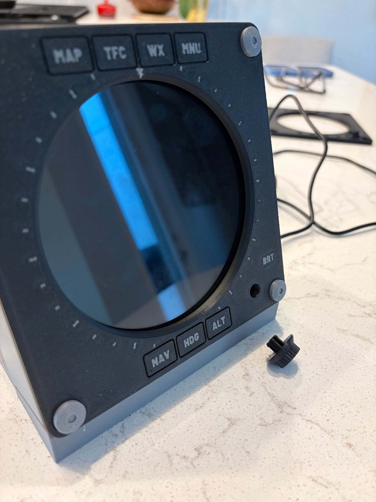
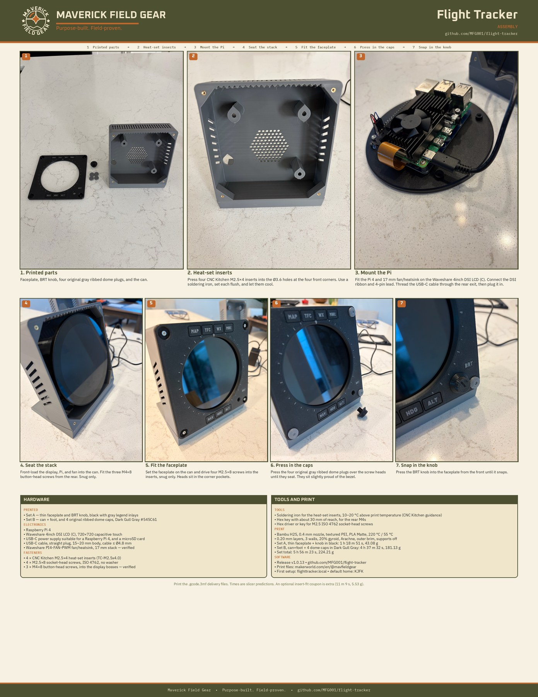

# Flight Tracker

A cockpit-style ADS-B display for a Raspberry Pi 4 and a Waveshare 4-inch DSI touch panel.

Flight Tracker by **Maverick Field Gear**. Purpose-built. Field-proven.

**[Print on MakerWorld](https://makerworld.com/en/models/3666834-flight-tracker-instrument-case)** · **[Download latest release](https://github.com/MFG001/flight-tracker/releases/latest)** · **[Build guide](docs/BUILD.md)** · **[License](LICENSE)**

## Contents

1. [What you need](#what-you-need)
2. [Build](#build)
3. [Software](#software)
4. [License](#license)

## What you need

### Printed parts

Print the case from the [MakerWorld listing](https://makerworld.com/en/models/3666834-flight-tracker-instrument-case). One profile, two plates. Use the thin faceplate and the original dome caps, not the later flush plugs.

- [ ] **Set A** — faceplate and knob (plate 1, black)
- [ ] **Set B** — can, foot, and four dome caps (plate 2, Dark Gull Gray)
- [ ] Optional insert-fit coupon

Both H2S and A1 print profiles are on the [MakerWorld listing](https://makerworld.com/en/models/3666834-flight-tracker-instrument-case). **H2S,** Set A + Set B — Full case (2 plates): about 5 h 56 m, 224 g. **A1,** A1 — Full case (2 plates): about 7 h 16 m, 224 g; plate 1 needs AMS lite for the gray legends. Supports off.

### Hardware

- [ ] Raspberry Pi 4 and a microSD card
- [ ] Waveshare 4inch DSI LCD (C) — not the 4-DSI-TOUCH-C
- [ ] Waveshare PI4-FAN-PWM fan and heatsink
- [ ] USB-C power supply and a **straight** USB-C cable
- [ ] 4 × M2.5×4 heat-set inserts
- [ ] 4 × M2.5×8 socket-head screws
- [ ] 3 × M4×8 button-head screws

The Pi mounts on the display kit’s standoffs. No receiver is required. The default feed is [adsb.fi](https://adsb.fi/).

### Tools

- Soldering iron for the inserts
- Hex key with about 30 mm of reach, for the rear M4s
- Hex driver for the M2.5 screws

## Build

Photos and full steps: **[docs/BUILD.md](docs/BUILD.md)**. Printable sheet: [assembly_sheet.pdf](https://mfg001.github.io/flight-tracker/assets/build/assembly_sheet.pdf).

1. Print Set A and Set B from [MakerWorld](https://makerworld.com/en/models/3666834-flight-tracker-instrument-case). Peel the brim.
2. Press four M2.5×4 inserts into the front corners of the can. Let them cool.
3. Mount the Pi and fan on the display. Thread the USB-C cable through the rear exit, then plug it in.
4. Front-load the stack. Fit the three M4×8 screws from the rear. Snug only.
5. Fit the faceplate with four M2.5×8 screws. Snug only.
6. Press the four dome caps over the screw heads.
7. Snap the BRT knob in from the front.

## Software

Install notes: **[docs/SOFTWARE.md](docs/SOFTWARE.md)**. Current release: [v1.0.13](https://github.com/MFG001/flight-tracker/releases/tag/v1.0.13).

1. Flash Raspberry Pi OS (desktop, Bookworm or Trixie). Set hostname and user to `flighttracker`, and enable SSH.
2. From a Mac or Linux computer, download the [latest release](https://github.com/MFG001/flight-tracker/releases/latest) and run `deploy/push-update.sh` against `flighttracker@flighttracker.local`.
3. If the Pi has no Wi-Fi, scan the on-screen QR, then save the home network at `http://10.42.0.1/`.
4. Open `http://flighttracker.local/` and set your location. The scope starts on KJFK.
5. Use the setup page Software card for updates. Auto-update is off by default.

## License

Software is under the [Maverick Field Gear Flight Tracker License](LICENSE): personal, non-commercial use; no modification or sale. Case print files are [CC BY-NC-ND 4.0](https://creativecommons.org/licenses/by-nc-nd/4.0/). Print files: [MakerWorld](https://makerworld.com/en/models/3666834-flight-tracker-instrument-case).

© 2026 Maverick Field Gear. All rights reserved.
