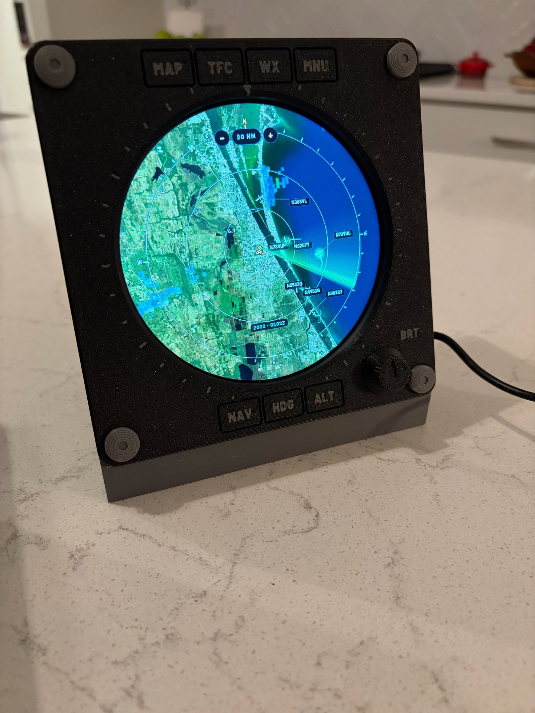
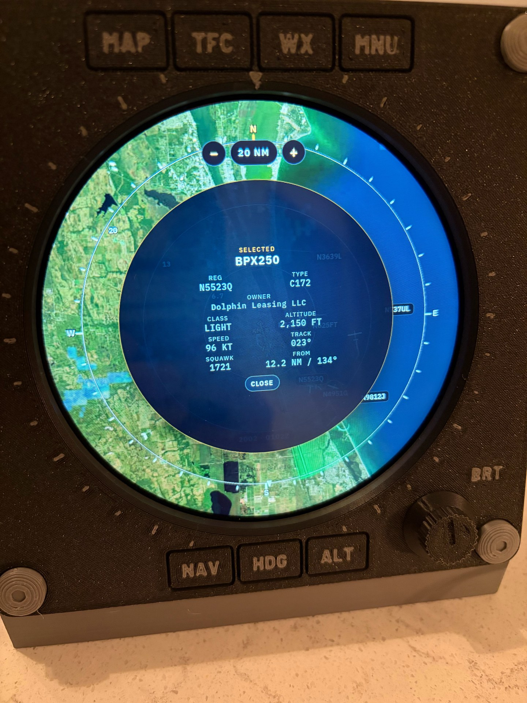

# Flight Tracker

A cockpit-style ADS-B display for a Raspberry Pi 4 and a Waveshare 4-inch DSI touch panel.






Flight Tracker by **Maverick Field Gear**. Purpose-built. Field-proven.

**[Print on MakerWorld](https://makerworld.com/en/models/3669492-aircraft-flight-tracker-desktop-ads-b-radar)** · **[Download latest release](https://github.com/MFG001/flight-tracker/releases/latest)** · **[Build guide](docs/BUILD.md)** · **[License](LICENSE)**

## Contents

1. [What you need](#what-you-need)
2. [Build](#build)
3. [Software](#software)
4. [License](#license)

## What you need

### Printed parts

Print the case from the [MakerWorld listing](https://makerworld.com/en/models/3669492-aircraft-flight-tracker-desktop-ads-b-radar). One profile, two plates. Use the thin faceplate and the original dome caps, not the later flush plugs.

- [ ] **Set A** — faceplate and knob (plate 1, black)
- [ ] **Set B** — can, foot, and four dome caps (plate 2, Dark Gull Gray)
- [ ] Optional insert-fit coupon

Both H2S and A1 print profiles are on the [MakerWorld listing](https://makerworld.com/en/models/3669492-aircraft-flight-tracker-desktop-ads-b-radar). **H2S,** Set A + Set B — Full case (2 plates): about 5 h 56 m, 224 g. **A1,** A1 — Full case (2 plates): about 7 h 16 m, 224 g; plate 1 needs AMS lite for the gray legends. Supports off.

### Hardware

- [ ] Raspberry Pi 4 and a microSD card
- [ ] Waveshare 4inch DSI LCD (C) — not the 4-DSI-TOUCH-C
- [ ] Waveshare PI4-FAN-PWM fan and heatsink
- [ ] USB-C power supply and a **straight** USB-C cable
- [ ] 4 × M2.5×4 heat-set inserts
- [ ] 4 × M2.5×8 socket-head screws
- [ ] 3 × M4×8 button-head screws

The Pi mounts on the display kit’s standoffs. No receiver is required. The default feed is [adsb.fi](https://adsb.fi/).

### Tools

- Soldering iron for the inserts
- Hex key with about 30 mm of reach, for the rear M4s
- Hex driver for the M2.5 screws

## Build

Photos and full steps: **[docs/BUILD.md](docs/BUILD.md)**. Printable sheet: [assembly_sheet.pdf](https://mfg001.github.io/flight-tracker/assets/build/assembly_sheet.pdf).


1. Print Set A and Set B from [MakerWorld](https://makerworld.com/en/models/3669492-aircraft-flight-tracker-desktop-ads-b-radar). Peel the brim.
2. Press four M2.5×4 inserts into the front corners of the can. Let them cool.
3. Mount the Pi and fan on the display. Thread the USB-C cable through the rear exit, then plug it in.
4. Front-load the stack. Fit the three M4×8 screws from the rear. Snug only.
5. Fit the faceplate with four M2.5×8 screws. Snug only.
6. Press the four dome caps over the screw heads.
7. Snap the BRT knob in from the front.

## Software

Install notes: **[docs/SOFTWARE.md](docs/SOFTWARE.md)**. Current release: [v1.0.17](https://github.com/MFG001/flight-tracker/releases/tag/v1.0.17).

1. Flash Raspberry Pi OS (64-bit) with Raspberry Pi Imager 2.0.12 or newer. Fill in every customisation step: hostname and user `flighttracker`, Wi-Fi country, and SSH with password login. An Ethernet cable is the most reliable first install. If you use Wi-Fi, check the card with [`prep-sd-card.sh`](https://raw.githubusercontent.com/MFG001/flight-tracker/main/deploy/prep-sd-card.sh) before the first boot. Tip: if your Wi-Fi name starts or ends with a space, Imager drops it and the Pi never joins. Either rename the network so it has no leading or trailing space, or fix the card with `bash prep-sd-card.sh wifi`. The screen stays blank until the software is installed. Full steps: [build guide, sections 6 and 7](docs/BUILD.md#6-flashing-the-os).
2. From a Mac or Linux computer on the same network as the tracker, install or update the software with `deploy/push-update.sh`. This is the manual update path when CHECK FOR UPDATES on `flighttracker.local` cannot be used.
   1. Download `flight-tracker-X.Y.Z.tar.gz` from the [latest release](https://github.com/MFG001/flight-tracker/releases/latest). It goes to your Downloads folder. If Safari turns it into a `.tar`, that's fine.
   2. Open Terminal and run these two commands one at a time, pressing Return after each. The first pulls the update script out of the download:

      ```
      cd ~/Downloads && tar xf flight-tracker-*.tar* deploy/push-update.sh
      ```

      The second sends the update to the tracker and installs it:

      ```
      bash deploy/push-update.sh
      ```

      The script uses the newest `flight-tracker-*.tar*` in `~/Downloads` and defaults to `flighttracker@flighttracker.local`. It asks for the tracker's login password, maybe twice, once to connect (ssh) and once to install (sudo). This is your own Pi login password, the one you set for the user `flighttracker` in Raspberry Pi Imager. Downloading from GitHub needs no account or password. When it finishes, the tracker restarts on the new version.
3. If the Pi has no Wi-Fi, scan the on-screen QR, then save the home network at `http://10.42.0.1/`.
4. Open `http://flighttracker.local/` and set your location. If that name does not load, use the IPv4 address shown on the Connected card. The scope starts on KJFK.
5. Use the setup page Software card for updates. Auto-update is off by default.

## License

Software is under the [Maverick Field Gear Flight Tracker License](LICENSE): personal, non-commercial use; no modification or sale. Case print files are [CC BY-NC-ND 4.0](https://creativecommons.org/licenses/by-nc-nd/4.0/). Print files: [MakerWorld](https://makerworld.com/en/models/3669492-aircraft-flight-tracker-desktop-ads-b-radar).

© 2026 Maverick Field Gear. All rights reserved.
