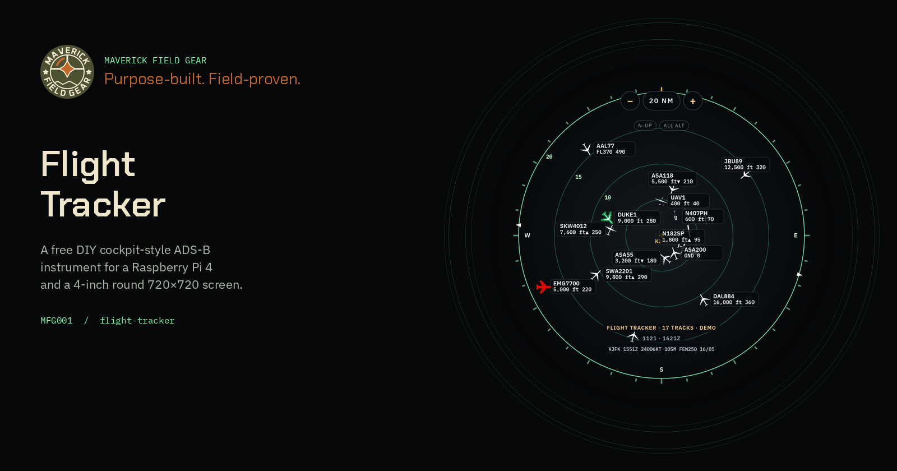
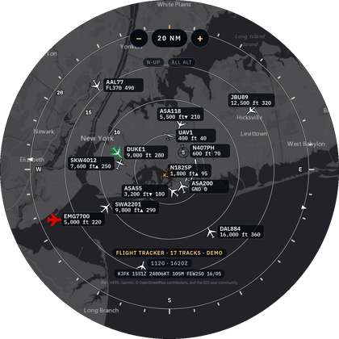
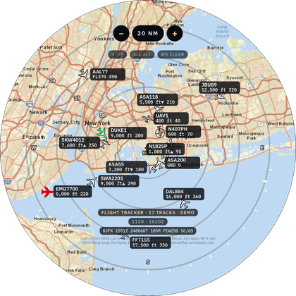
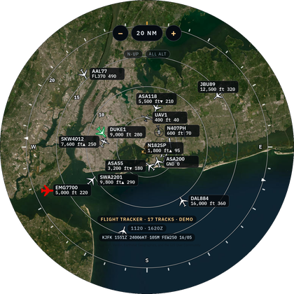
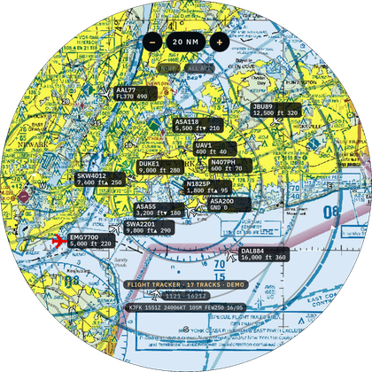
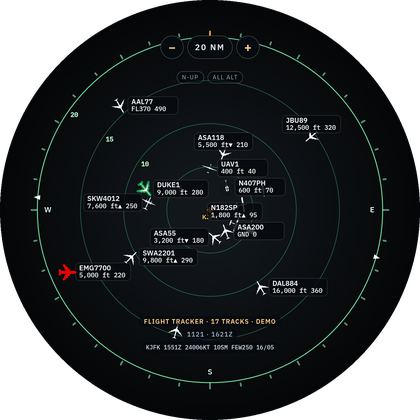
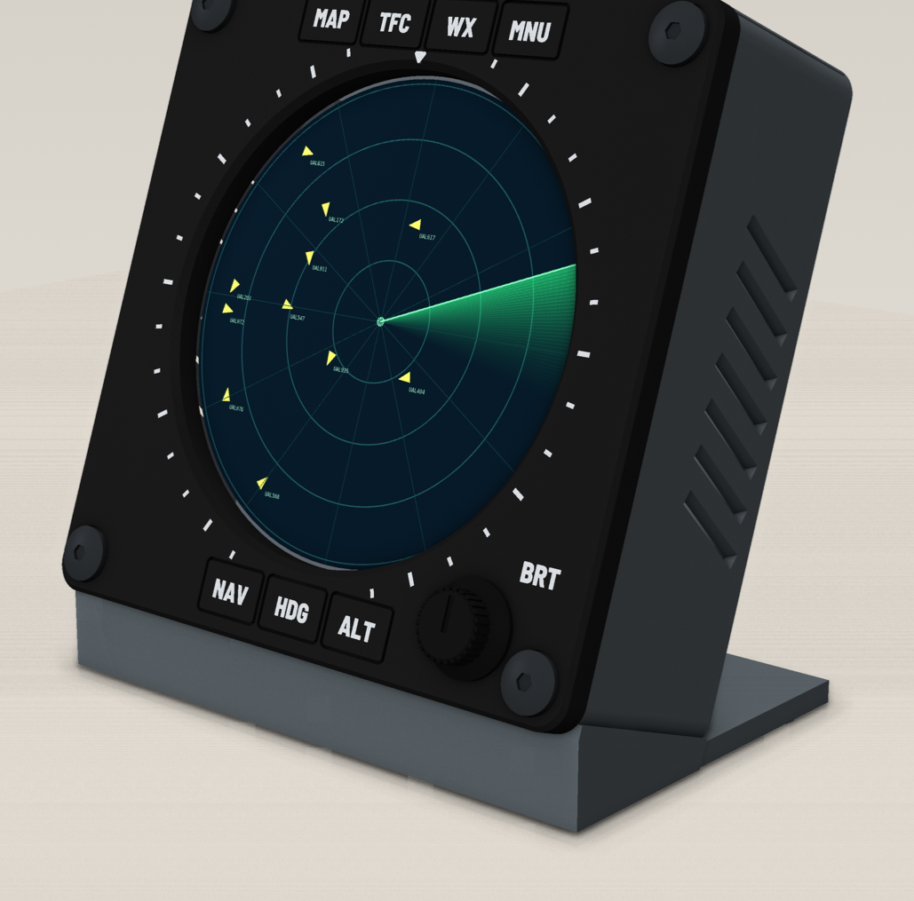
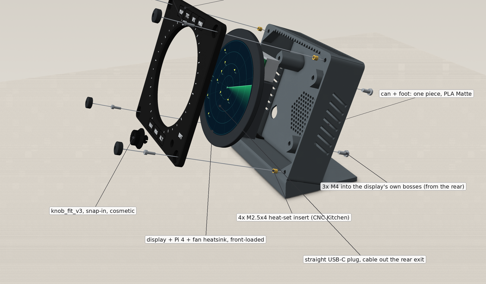

# Flight Tracker

[](https://github.com/MFG001/flight-tracker)

**Maverick Field Gear**  
Purpose-built. Field-proven.

A free DIY kit: a cockpit-style ADS-B display for a Raspberry Pi 4 and a Waveshare 4-inch, 720×720 DSI touch panel. Live traffic is drawn inside the circular glass, with range rings, precipitation radar, emergency alerts, and five map styles. The eight bezel actions are printed on the case.

The kit is free on GitHub and MakerWorld. It is not sold.

- Software and signed releases: [github.com/MFG001/flight-tracker](https://github.com/MFG001/flight-tracker)
- Print files: [MakerWorld listing](https://makerworld.com/en/models/3669492-aircraft-flight-tracker-desktop-ads-b-radar) ([@mavfieldgear](https://makerworld.com/en/@mavfieldgear))
- New units open on **KJFK** until you set your own location

## Features

- **Live aircraft radar.** Planform icons, colour-coded altitude, callsign and speed, and range rings. Select **10, 20, 30, 40, 50, 75, or 100 NM**. **100 NM is the maximum**. Tap a target for identity, track, vertical speed, distance, and squawk. Use the public [adsb.fi](https://adsb.fi/) feed, or point the unit at your own readsb or dump1090 receiver.
- **Weather radar.** A precipitation overlay, animated from RainViewer, with a NEXRAD composite fallback. The nearest METAR sits on the glass. The WX key toggles the overlay; opacity is set on the setup page.
- **Emergency alerts.** A squawk of 7500, 7600, or 7700, or an emergency flag from the receiver, flashes the icon red. An optional chime can be armed. Only an emergency holds off a waiting software-update prompt.
- **Signed, tokenless updates.** When a new signed release is ready, the round screen offers **UPDATE NOW** or **LATER**. Later, or no answer within two minutes, books the install for the time you set on the Software card (2:00 AM Eastern by default). Automatic night installs are off until you turn them on. Releases are signed with Ed25519 and published on this public repository — no API token on the Pi. A failed health check rolls the previous version back.
- **Five map styles.** Dark canvas, street map, satellite, FAA VFR sectional, and a drawn radar scope. Cycle them with the MAP key.

Demo screenshots below use bundled sample tracks, home at KJFK, 20 NM.

| Dark | Light + weather | Satellite | Sectional | Scope |
| --- | --- | --- | --- | --- |
|  |  |  |  |  |



The compact B case is 140 × 155 × 100 mm, printed as two plates. Both H2S and A1 print profiles are on the [MakerWorld listing](https://makerworld.com/en/models/3669492-aircraft-flight-tracker-desktop-ads-b-radar). H2S, Set A + Set B — Full case (2 plates): about 5 h 56 m, 224 g. A1 — Full case (2 plates): about 7 h 16 m, 224 g; plate 1 needs AMS lite for the gray legends. Supports off.

## What you need

### Print (H2S and A1 profiles on MakerWorld)

About 5 hours 56 minutes and 224 g for the set (Set A + Set B). Finished size 140 × 154.7 × 100.3 mm.

- Set A: thin faceplate and BRT knob — black with grey legend inlays
- Set B: can + foot, and four original dome caps — Dark Gull Gray

### Electronics

- Raspberry Pi 4
- Waveshare 4inch DSI LCD (C), 720 × 720 capacitive touch
- USB-C power supply suitable for a Raspberry Pi 4, and a microSD card
- Raspberry Pi OS Bookworm or Trixie, with a desktop
- USB-C cable, straight plug, 15–20 mm body
- Optional cooling fan

### Fasteners

- 4 × CNC Kitchen M2.5×4 heat-set inserts
- 4 × M2.5×8 socket-head screws, ISO 4762
- 3 × M4×8 button-head screws, into the display’s own bosses

Rear depth is designed for a 17 mm Waveshare PI4-FAN-PWM fan heatsink; that stack fits and works on the built unit.

The illustrated, step-by-step guide and a one-page assembly sheet are in the [build guide](build.html) on the site, and in `docs/BUILD.md` in the software repository.

## Build overview



1. Print Set A (thin faceplate and knob, black) and Set B (can, foot, and four dome caps, Dark Gull Gray). Supports off.
2. Press the four M2.5×4 heat-set inserts into the front corners of the can.
3. Flash Raspberry Pi OS, connect the display, clone this repository, and run `sudo bash install.sh`.
4. Thread the USB-C cable through the rear exit from the outside, then plug it into the Pi.
5. Front-load the display, Pi, and fan. Fit the three M4s from the rear.
6. Fit the faceplate with four M2.5 screws, press on the caps, and snap in the knob.
7. On first boot, scan the on-screen QR to join Wi-Fi. The scope opens on KJFK until you set a home airport on the setup page at `flighttracker.local`.

## Install

Flash Raspberry Pi OS Bookworm or Trixie with a desktop. Connect the 4inch DSI LCD (C) with the 15-pin FPC and the 4-pin power and I2C lead. Clone this repository, then:

```bash
sudo bash install.sh
```

Reboot after the display overlay is added. The hostname is `flighttracker`. The setup page answers at `flighttracker.local`. If no Wi-Fi is saved, the display shows a QR code for a setup network. Join it, then save your own network.

The installer writes the Pi 4 display overlay, starts the local server and the fullscreen kiosk, and leaves settings in `/etc/flight-tracker/config.json`. Full hardware notes and the control map live in this repository.

## Updates

Releases are Ed25519-signed and published on this public repository. The unit fetches the latest manifest over HTTPS, with no API token and no credentials. It refuses older or equal versions, mismatched signatures, and downloads that are not from approved GitHub hosts.

When an update is ready, the round screen asks **UPDATE NOW** or **LATER**:

- **UPDATE NOW** starts the install immediately.
- **LATER**, or no answer within two minutes, books the install for the next “Install later at” time on the Software card. That time defaults to **2:00 AM Eastern**; you can change it.
- Automatic installs at that hour are **off** by default.
- Only an emergency alert holds off the prompt.

After install, a health check runs. If it fails, the previous version is restored.

## License

Software in this repository is released under the [Maverick Field Gear Flight Tracker License](LICENSE). It is source-available and free to install and run on a personal build, for non-commercial use. You may not modify it, distribute modified versions, or sell it. The full text is in the repository `LICENSE` file.

Case print files are licensed under [CC BY-NC-ND 4.0](https://creativecommons.org/licenses/by-nc-nd/4.0/). Print files are on the [MakerWorld listing](https://makerworld.com/en/models/3669492-aircraft-flight-tracker-desktop-ads-b-radar) ([@mavfieldgear](https://makerworld.com/en/@mavfieldgear)).

© 2026 Maverick Field Gear. All rights reserved.

## Credits

Flight Tracker by **Maverick Field Gear**. Purpose-built. Field-proven.

Maps: Esri, OpenStreetMap contributors, and the GIS user community. Sectional: FAA Aeronautical Information Services. Weather: RainViewer and the Iowa Environmental Mesonet. METAR: Aviation Weather Center, NOAA/NWS. Live aircraft: [adsb.fi](https://adsb.fi/) open data, or your own receiver.
