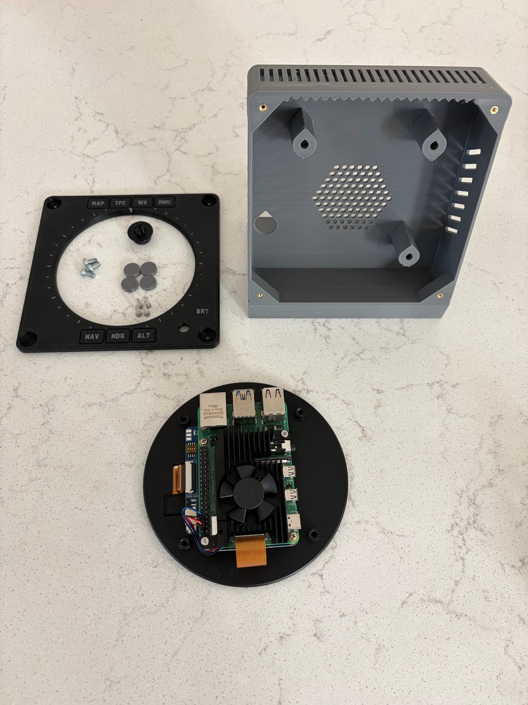
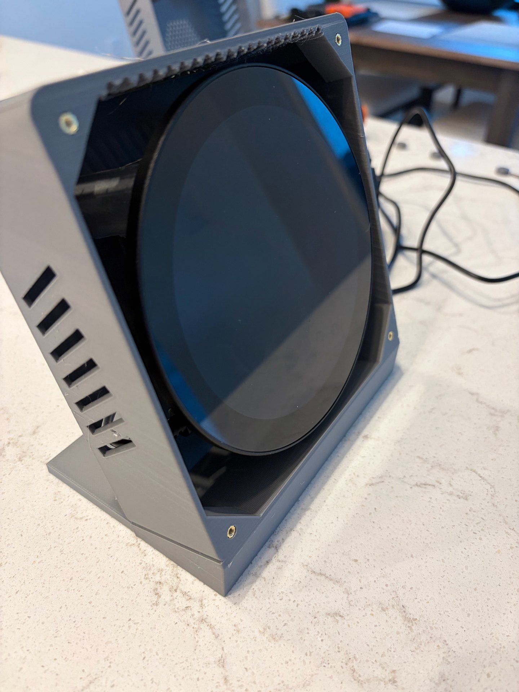
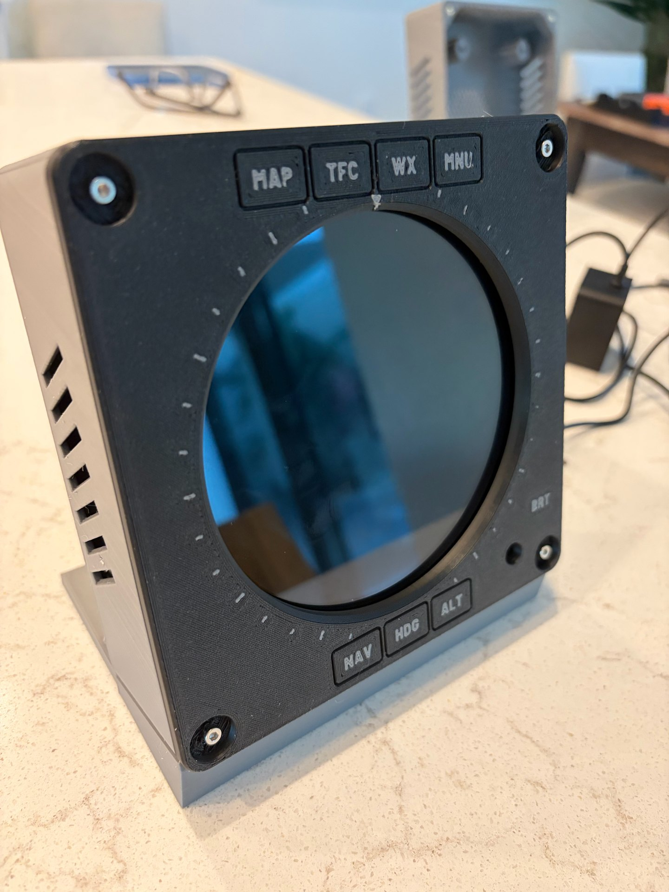
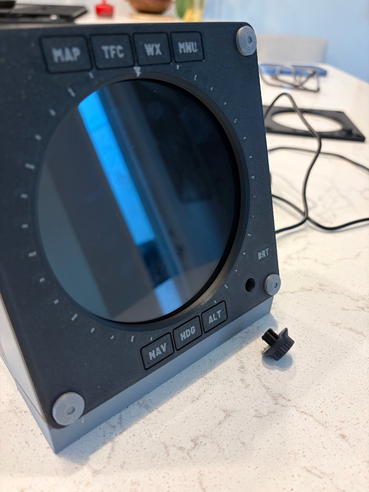
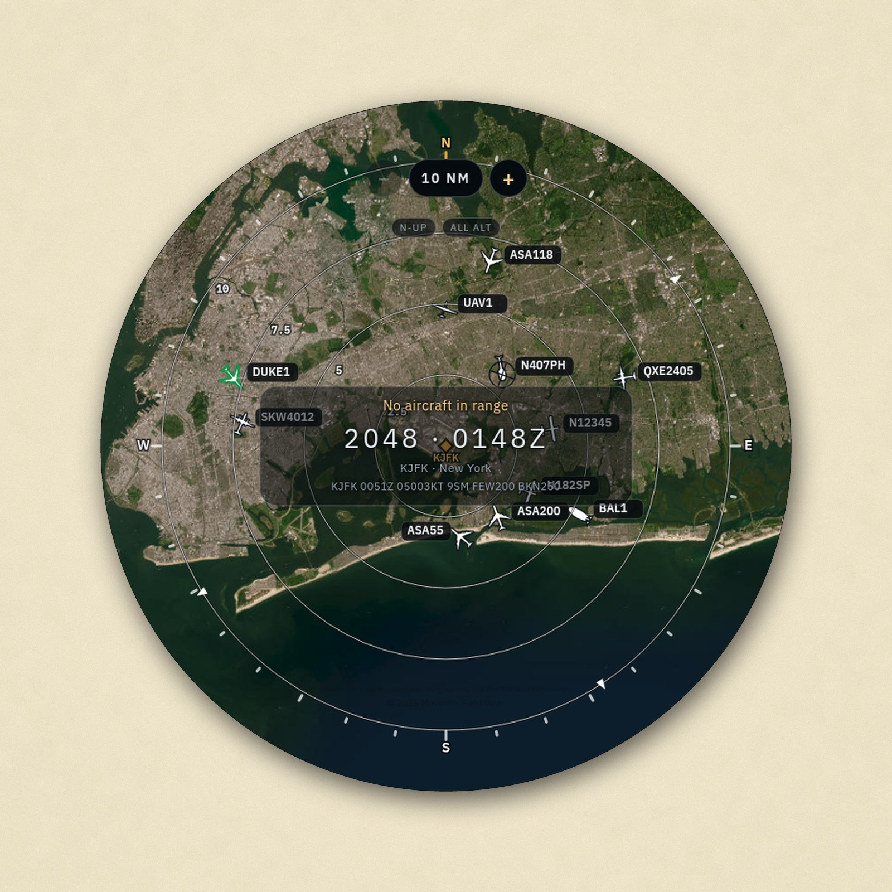
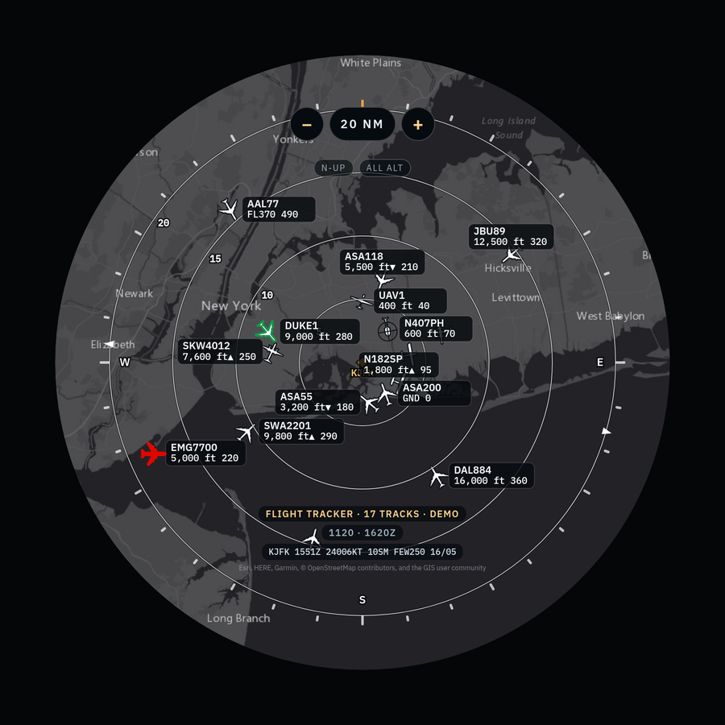
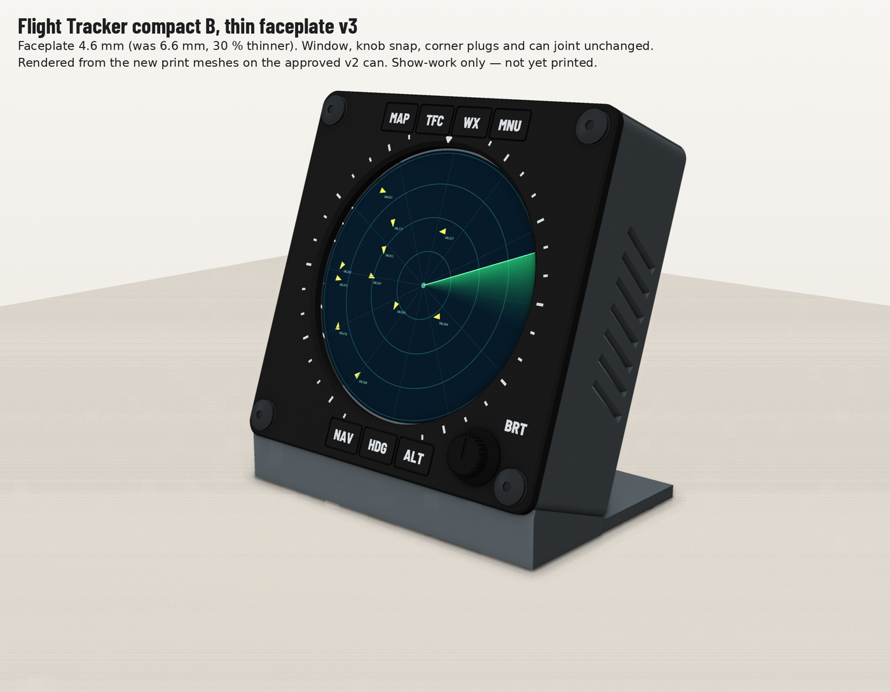

# Build the Flight Tracker

[Flight Tracker](../README.md) / Build guide

**[README](../README.md)** · **Build guide** · [Software](SOFTWARE.md) · [Signed updates](tokenless-updates.md) · [Wi-Fi QR test](wifi-qr-test.md)


Flight Tracker by **Maverick Field Gear**. Purpose-built. Field-proven.

This is the step-by-step build for the compact B desk instrument: a 140 mm printed case, a Raspberry Pi 4, and a Waveshare 4inch DSI LCD (C). The current software release is [v1.0.18](https://github.com/MFG001/flight-tracker/releases/tag/v1.0.18). Print files are on the [MakerWorld listing](https://makerworld.com/en/models/3669492-aircraft-flight-tracker-desktop-ads-b-radar) ([@mavfieldgear](https://makerworld.com/en/@mavfieldgear)).

A one-page letter assembly sheet, with the hardware photographs, a parts list, and print settings, is shown below. A printable PDF of the same sheet is on the [Pages build guide](https://mfg001.github.io/flight-tracker/build.html) as [assembly_sheet.pdf](https://mfg001.github.io/flight-tracker/assets/build/assembly_sheet.pdf).


## Contents

1. [Parts and hardware](#1-parts-and-hardware)
2. [Printing](#2-printing)
3. [Heat-set inserts](#3-heat-set-inserts)
4. [Mounting the Pi, fan, and display](#4-mounting-the-pi-fan-and-display)
5. [Closing the case](#5-closing-the-case)
6. [Flashing the OS](#6-flashing-the-os)
7. [Installing the software](#7-installing-the-software)
8. [First setup](#8-first-setup)
9. [Troubleshooting](#9-troubleshooting)

## 1. Parts and hardware

Finished size is about **140 × 155 × 100 mm**. Both H2S and A1 print profiles are on the [MakerWorld listing](https://makerworld.com/en/models/3669492-aircraft-flight-tracker-desktop-ads-b-radar).



The faceplate, knob, four original gray ribbed dome plugs, screws, can, and the Pi already mounted on the round display.

### Printed parts

| Part | Colour | Delivery file (print the `.gcode.3mf`) |
| --- | --- | --- |
| Set A: 140 mm thin faceplate and BRT knob | Black `#161616` with Dark Gull Gray `#545C61` legend inlays (AMS) | `FlightTracker_SetA_faceplate_knob_black_H2S.gcode.3mf` |
| Set B: can + foot, and four original dome caps | Dark Gull Gray `#545C61` | `FlightTracker_SetB_can_caps_gray_H2S.gcode.3mf` |
| Optional insert-fit coupon | Gray | `FlightTracker_compactB_H2S_insert_coupon.gcode.3mf` |

Set A is the thin faceplate and the knob. Set B is the can and foot, plus the four original ribbed dome caps in Dark Gull Gray. These are the original dome caps, not the later flush (flat) plugs.


Printed parts, ready to assemble. The four gray ribbed parts are the original dome plugs.


The thin 140 mm faceplate, printed face-down, with MAP / TFC / WX / MNU along the top and NAV / HDG / ALT along the bottom.

### Electronics

| Qty | Part | Notes |
| --- | --- | --- |
| 1 | Raspberry Pi 4 | The installer default is a Pi 4 |
| 1 | Waveshare **4inch DSI LCD (C)**, 720 × 720 capacitive touch | Confirm the model on the board. This is not the 4-DSI-TOUCH-C, which needs a different overlay |
| 1 | USB-C power supply suitable for a Raspberry Pi 4, and a microSD card | Raspberry Pi OS Bookworm or Trixie, with a desktop |
| 1 | USB-C cable, **straight** plug | 15–20 mm body, cable no thicker than about Ø4.8 mm. No 90° adapter is needed |
| 1 | Cooling fan and heatsink on the Pi | Waveshare PI4-FAN-PWM. The 17 mm stack fits and works on the built unit |

The Pi screws into the display kit’s own standoffs.

### Fasteners

| Qty | Part | Where |
| --- | --- | --- |
| 4 | CNC Kitchen M2.5×4 heat-set inserts (TC-M2.5x4.0) | Front corners of the can |
| 4 | M2.5×8 socket-head screws, ISO 4762, no washer | Faceplate to the can, under the corner plugs |
| 3 | M4×8 button-head screws, into the display’s own bosses | From the rear. The lower-left display mount is omitted. Verified on the built unit: 3 × M4×8 |

No washers, and no nameplate screws.

## 2. Printing

Both print profiles are on the [MakerWorld listing](https://makerworld.com/en/models/3669492-aircraft-flight-tracker-desktop-ads-b-radar), PLA, supports off.

- **H2S,** Set A + Set B — Full case (2 plates): about **5 h 56 m**, **224 g**
- **A1,** A1 — Full case (2 plates): about **7 h 16 m**, **224 g**. Plate 1 needs AMS lite for the gray legends.

The H2S delivery files use a 0.4 mm nozzle, textured PEI, and PLA Matte at 220 °C / 55 °C.

H2S plate times:

| Set | Time | Filament |
| --- | --- | --- |
| Set A, thin faceplate + knob in black (AMS) | **1 h 18 m 51 s** | **43.08 g** (42.39 g black + 0.68 g grey) |
| Set B, can + foot + 4 dome caps in Dark Gull Gray | **4 h 37 m 32 s** | **181.13 g** |
| Optional insert-fit coupon | 11 m 9 s | 5.53 g |
| **Set total** (A + B) | **5 h 56 m 23 s** | **224.21 g** |

Times are slicer predictions. The coupon is extra and is not in the set totals above. Print the `.gcode.3mf` for your printer. The faceplate prints face-down. Peel the brim. There are no supports to remove.


The rear: three M4 ports, the fan grille, and the wedge foot.

## 3. Heat-set inserts

Press the four CNC Kitchen M2.5×4 inserts into the front corners of the can before you load the electronics.


The four brass inserts, set flush at the front corners. These should need heat.

1. Stand the can on its foot with the front face up and level, or prop it so the front face is level.
2. Use a soldering iron at 10–20 °C above print temperature (CNC Kitchen guidance).
3. Go straight down each hole’s own axis, square to the front face.
4. Set each insert flush with the column face, and square to it.
5. Let the inserts cool before you load the electronics.

Print the optional coupon first if you want to confirm the insert fit.

## 4. Mounting the Pi, fan, and display

Build the display stack on the bench first, then load it into the can.


The Pi 4 on the back of the Waveshare 4inch DSI LCD (C), with the fan and heatsink, the amber DSI ribbon, the 4-pin power and I2C lead, and a straight USB-C cable.

1. Mount the Pi on the display kit’s own standoffs. Fit the cooling fan and heatsink if you are using one.
2. Connect the 15-pin DSI FPC between the display and the Pi’s DSI connector, and connect the 4-pin lead for 5 V and I2C, as in the [4inch DSI LCD (C) wiki](https://www.waveshare.com/wiki/4inch_DSI_LCD_(C)). In the photograph the ribbon is looped at the side of the Pi.
3. **Before** you seat the stack, thread the USB-C cable through the rear exit from the **outside**, plug end first. Then plug it into the Pi.
4. Confirm the board is **4inch DSI LCD (C)**. A Pi 4 has one 15-pin DSI connector.

Display orientation in this case: USB-C at the lower left, pointing left. The Waveshare PI4-FAN-PWM 17 mm stack fits and works. A taller heatsink may not clear the rear wall.



The display seated in the can, before the faceplate goes on.

5. Front-load the display, Pi, and fan stack into the can.
6. Fit the **three** display M4s from the rear, into the display’s own bosses. A hex key needs about 30 mm of reach. Snug only.

## 5. Closing the case

Fit the faceplate, press in the caps, then snap in the knob from the front.



1. Set the faceplate on the can. Drive four M2.5×8 screws into the inserts, snug only.



2. Press the four original gray ribbed dome plugs straight over the screw heads until they seat. They sit slightly proud of the bezel. These are the original dome caps, not the later flush (flat) plugs.


3. Press the BRT knob into the faceplate from the front, until it snaps.

If a dome plug is too tight, warm it slightly or ream lightly. If it is loose, a dot of glue will hold it.

## 6. Flashing the OS

Use [Raspberry Pi Imager](https://www.raspberrypi.com/software/) 2.0.12 or newer on your Mac or PC, not the Pi.

The tracker's screen stays **blank until the software is installed**. The display driver comes with the install, so a blank screen with a solid red light and a flickering green light on the Pi is normal at this stage.

**Use an Ethernet cable for the first install if you can.** Plug the Pi into a spare port on your router or switch. It then needs no Wi-Fi settings at all, and the on-screen QR setup can add Wi-Fi after the install.

1. Choose **Raspberry Pi 4**, then **Raspberry Pi OS (64-bit)**, the one with a desktop. It is Trixie. Then choose the card.
2. Fill in **every** customisation step. Do not skip customisation:
   - Hostname: `flighttracker`
   - Localisation: your time zone, keyboard and **Wi-Fi country** (US in the United States).
   - User: `flighttracker`, with a password you will remember. You type it during the install.
   - Wi-Fi: your network name and password, or leave it empty if you use Ethernet. Imager fills these in from the Mac's current network. Check the name is your home network, not a guest or IoT one.
   - Remote access: **Enable SSH**, with **password authentication**.
3. Write the card. When Imager says it is done, take the card out and put it back in the Mac. A disk named **bootfs** appears.
4. Check the card before the first boot:

   ```bash
   cd ~/Downloads && curl -fsSLO https://raw.githubusercontent.com/MFG001/flight-tracker/main/deploy/prep-sd-card.sh
   ```

   ```bash
   bash prep-sd-card.sh
   ```

   The first command downloads [`prep-sd-card.sh`](https://raw.githubusercontent.com/MFG001/flight-tracker/main/deploy/prep-sd-card.sh) from this repository. Downloading from GitHub needs no account or password. The script is also in release tarballs after 1.0.14, as `deploy/prep-sd-card.sh`.

   Every line should say `OK`. The Wi-Fi line shows the network name in brackets with its length, for example `[Home Net] (8 characters)`. Compare it with your router's name character for character.

   > **Network names that start or end with a space.** Imager 2.x removes spaces at the start and end of the Wi-Fi name, so a network called `Home Net ` is written as `Home Net` and the Pi never joins it. Either rename the network in your router so it has no leading or trailing space, then flash again, or run `bash prep-sd-card.sh wifi`, type the name exactly, with the space, and the Wi-Fi password. It rewrites the card's Wi-Fi settings and leaves everything else alone.

5. Eject **bootfs**, put the card in the Pi, plug in Ethernet if you are using it, and power on.
6. Wait **5 minutes**. The first boot sets up the system and restarts once. The screen stays blank.

Raspberry Pi OS (Legacy) Bookworm also works, but `prep-sd-card.sh` can only check it, not fix it.

## 7. Installing the software

Do this from a Mac or Linux computer on the **same network** as the tracker, not on the Pi. If your router has more than one network (for example a main LAN and a separate IoT or guest network), the Mac and the tracker must be on the same one.

1. Find the tracker. Open your router's app (UniFi Network, for example) and look in the client list for **flighttracker**. Note its IP address. If it is not listed after 5 minutes, see [the Wi-Fi checks in Troubleshooting](#9-troubleshooting).
2. Download the release. The current release is [v1.0.18](https://github.com/MFG001/flight-tracker/releases/tag/v1.0.18). Download `flight-tracker-1.0.18.tar.gz` from that page. Safari may unzip the download to a `.tar` file, which also works.
3. In Terminal, run these one at a time, pressing Return after each:

   ```bash
   cd ~/Downloads && tar xf flight-tracker-*.tar* deploy/push-update.sh
   ```

   ```bash
   bash deploy/push-update.sh
   ```

   If it says `Could not resolve hostname flighttracker.local`, use the IP address from step 1 instead, keeping the user `flighttracker`. Replace `TRACKER-IP` with that address:

   ```bash
   bash deploy/push-update.sh ~/Downloads/flight-tracker-1.0.18.tar flighttracker@TRACKER-IP
   ```

The script asks for the tracker's password for SSH, then again when `sudo` on the Pi asks. This is your own Pi login password, the one you set for the user `flighttracker` in Raspberry Pi Imager. It is not a GitHub password: downloading from GitHub needs no account or password. The first time, SSH also asks `Are you sure you want to continue connecting?`. Type `yes`. It copies the release, unpacks it, and runs `sudo bash install.sh` on the Pi. When it finishes it prints `flight-tracker.service is running 1.0.18`. Then reboot so the display overlay is applied:

```bash
ssh flighttracker@flighttracker.local 'sudo reboot'
```

Use the IP address in place of `flighttracker.local` here too if needed.

The installer writes the Pi 4 overlay for the 4inch DSI LCD (C), copies the app to `/opt/flight-tracker`, starts `flight-tracker.service` and the fullscreen kiosk, sets the hostname, enables Avahi so the unit answers at `flighttracker.local`, and leaves settings in `/etc/flight-tracker/config.json`. If you later have the other Waveshare board, 4-DSI-TOUCH-C, that is a different overlay; see the [software notes](SOFTWARE.md#hardware).

If you installed over Ethernet, add Wi-Fi now: unplug the cable and reboot. With no Wi-Fi saved, the screen shows the **FlightTracker-Setup** QR code. See [Wi-Fi QR setup](#wi-fi-qr-setup).

You can also clone this repository on the Pi and run `sudo bash install.sh` from the tree. The release tarball and `push-update.sh` are the usual first install from a computer on the LAN.

## 8. First setup

The setup page is `http://flighttracker.local/`. Open it from a phone or computer on the same network.

The scope opens centred on **KJFK**, John F. Kennedy International Airport (latitude 40.6399, longitude −73.7787, the FAA airport reference point). METAR starts at KJFK and follows the home airport when you set one by airport search. A latitude and longitude home uses the nearest station, unless you type a METAR station on the setup page. Set your own home on the setup page: an airport-code search, or a latitude and longitude. Save writes `/etc/flight-tracker/config.json` and the running display picks it up without a reboot.

### Wi-Fi QR setup

If the Pi has no saved Wi-Fi, the round display raises a WPA hotspot named **FlightTracker-Setup**. The password is random per device, eight letters, and is shown under a QR code on the glass. A phone camera can scan `WIFI:T:WPA;S:FlightTracker-Setup;P:<password>;;`.

When the phone joins, the display switches to a second QR code for `http://10.42.0.1/`. That is the setup hotspot address. On that hotspot, `http://flighttracker.local/` also resolves to the unit. Save the home Wi-Fi there. After the home network connects, the card changes to “Connected” and a QR code for the unit’s current IPv4 address, then closes. Join that same Wi-Fi, then scan or type the address.

**MNU → WI-FI SETUP** opens the card again.

### Updates

The Software section on `http://flighttracker.local/` is the place to check, read notes, install, or turn on auto-update.

- A daily check runs at about **09:00 AM Eastern** (America/New_York), with up to five minutes of random delay, so the on-screen prompt appears while people are awake. A unit that was off at 9:00 catches up when it next comes on.
- Background checks 90 seconds after boot and every 6 hours are skipped between 21:00 and 09:00 Eastern.
- **CHECK FOR UPDATES** on the Software card always runs at once.
- When a signed release is ready, the round screen offers **UPDATE NOW** or **LATER**. Later, or no answer within two minutes, books the install for the “Install later at” time (2:00 AM Eastern by default).
- Automatic night installs are **off** until you turn them on. If you turn them on, a 03:10 AM Eastern timer may install when the hour is between 01:00 and 05:00 and the glass and setup page have been idle for 15 minutes.
- Releases are Ed25519-signed and published on this public repository. No API token is stored on the Pi. A failed health check rolls the previous version back.

## 9. Troubleshooting

Restart the kiosk if the glass is up but the display is stuck or blank:

```bash
ssh flighttracker@flighttracker.local 'sudo systemctl restart flight-tracker-kiosk'
```

Other useful checks:

```bash
ssh flighttracker@flighttracker.local 'systemctl status flight-tracker.service flight-tracker-kiosk.service'
ssh flighttracker@flighttracker.local 'sudo journalctl -u flight-tracker.service -n 50 --no-pager'
```

| Symptom | What to try |
| --- | --- |
| `flighttracker.local` does not resolve, and the tracker is not in the router’s client list | It has not joined the network. Before the software is installed there is no QR setup. Use an Ethernet cable, or put the card in the Mac and run [`prep-sd-card.sh`](https://raw.githubusercontent.com/MFG001/flight-tracker/main/deploy/prep-sd-card.sh) (`bash prep-sd-card.sh`). If the Wi-Fi name starts or ends with a space, rename the network, or fix the card with `bash prep-sd-card.sh wifi`. Check the router: the network should offer 2.4 GHz or 5 GHz (not 6 GHz only), WPA2 or WPA2/WPA3 (not WPA3 only), and MLO off. |
| `flighttracker.local` does not resolve, but the tracker is in the client list | Use its IP address from the list. Check the Mac is on the same network (same first three numbers of the IP address). Multicast or mDNS blocking on the router can also stop `.local` names. |
| The script cannot log in | Hostname and username should both be `flighttracker`. Enable SSH with password authentication in Imager. Run `bash prep-sd-card.sh` on the card to check. The password is the one you set in Imager for `flighttracker`. |
| The card was flashed without customisation | There is no `flighttracker` user and SSH is off, so nothing can log in, even over Ethernet. Flash it again and fill in every customisation step. |
| `WARNING: REMOTE HOST IDENTIFICATION HAS CHANGED!` after reflashing | A fresh card has new SSH host keys, so your computer's saved key for the old card no longer matches. Remove it with `ssh-keygen -R flighttracker.local`, and also `ssh-keygen -R` followed by the IP address if you used one, then run the command again. Two units both named `flighttracker` on one network also clash: they share the name `flighttracker.local`. Use each unit's IP address, or power one off while you set up the other. |
| `sudo: a terminal is required` | Use the `push-update.sh` from this release (1.0.6 and later). Run it in a real Terminal window, not a pipe. |
| Safari turned the download into `.tar` | That is fine. Pass the `.tar` path to `push-update.sh`. |
| The display is blank or the wrong size after the first install | Reboot so the Waveshare overlay loads. Confirm the board is 4inch DSI LCD (C), not 4-DSI-TOUCH-C. |
| No Wi-Fi after the software is installed | Use the on-screen FlightTracker-Setup QR, then save the home network at `http://10.42.0.1/`. |
| An update never appears | Tap **CHECK FOR UPDATES** on the Software card. The automatic check is at 9:00 AM Eastern. |
| The kiosk does not come back after an update | Restart it with the command above. `journalctl` on `flight-tracker.service` shows whether the server came up as the new version. |

## What the glass shows

Sample screens from [v1.0.13](https://github.com/MFG001/flight-tracker/releases/tag/v1.0.13), home at KJFK, 20 NM, using the bundled demo traffic (not a live feed). Each aircraft label is the tail number; tap the label, not the icon, for the detail card. Helicopter rotors spin on the glass. These three images are the 1.0.13 previews, each on a different background.

| Traffic | Detail card | Standby |
| --- | --- | --- |
|  |  |  |

Map backgrounds, from the built-in demo. Cycle them with **MAP**.

| Dark | Light | Satellite | Sectional | Scope |
| --- | --- | --- | --- | --- |
|  |  |  |  |  |

A render of the thin faceplate on the compact B can:



## Verified on the built unit, and still unverified

**Verified on the built unit:**

- **Display screws:** 3 × M4×8 button-head screws, into the display’s own bosses, from the rear.
- **Fan and heatsink:** Waveshare PI4-FAN-PWM, 17 mm stack, fits and works.

**Still unverified:**

- **USB-C plug length.** A straight 15–20 mm plug is designed to fit, and a straight plug is shown in the photographs.
- First boot on the physical 720 × 720 panel, touch alignment, Avahi, the setup hotspot, a real over-the-air install, and backlight sysfs writes were not verified in this environment. The [software notes](SOFTWARE.md#verified-here-and-not-verified-on-the-hardware) list those items in full.

## License

Software is under the [Maverick Field Gear Flight Tracker License](../LICENSE). It is source-available and free to install and run on a personal build, for non-commercial use. You may not modify it, distribute modified versions, or sell it.

Case print files are [CC BY-NC-ND 4.0](https://creativecommons.org/licenses/by-nc-nd/4.0/). Print files are on the [MakerWorld listing](https://makerworld.com/en/models/3669492-aircraft-flight-tracker-desktop-ads-b-radar).

---

[← README](../README.md) · [Software →](SOFTWARE.md)

© 2026 Maverick Field Gear. All rights reserved.
