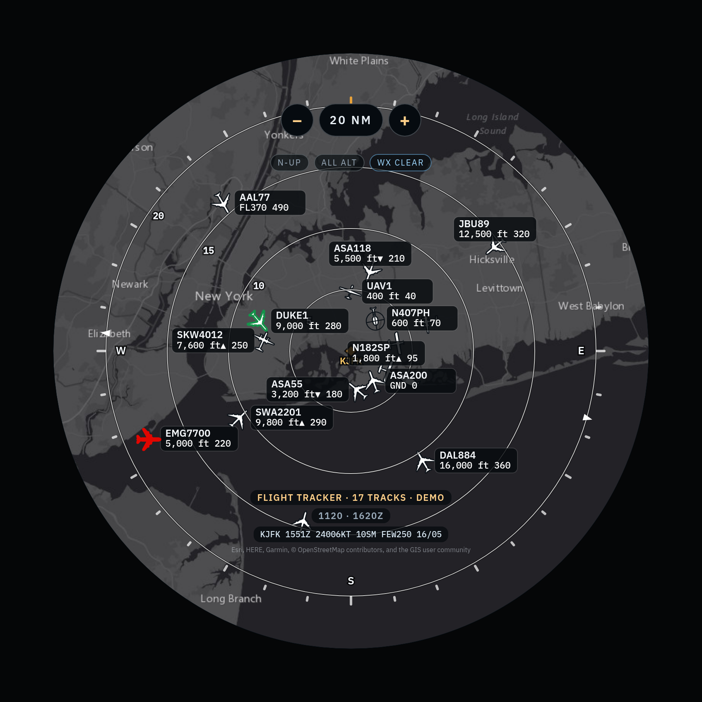
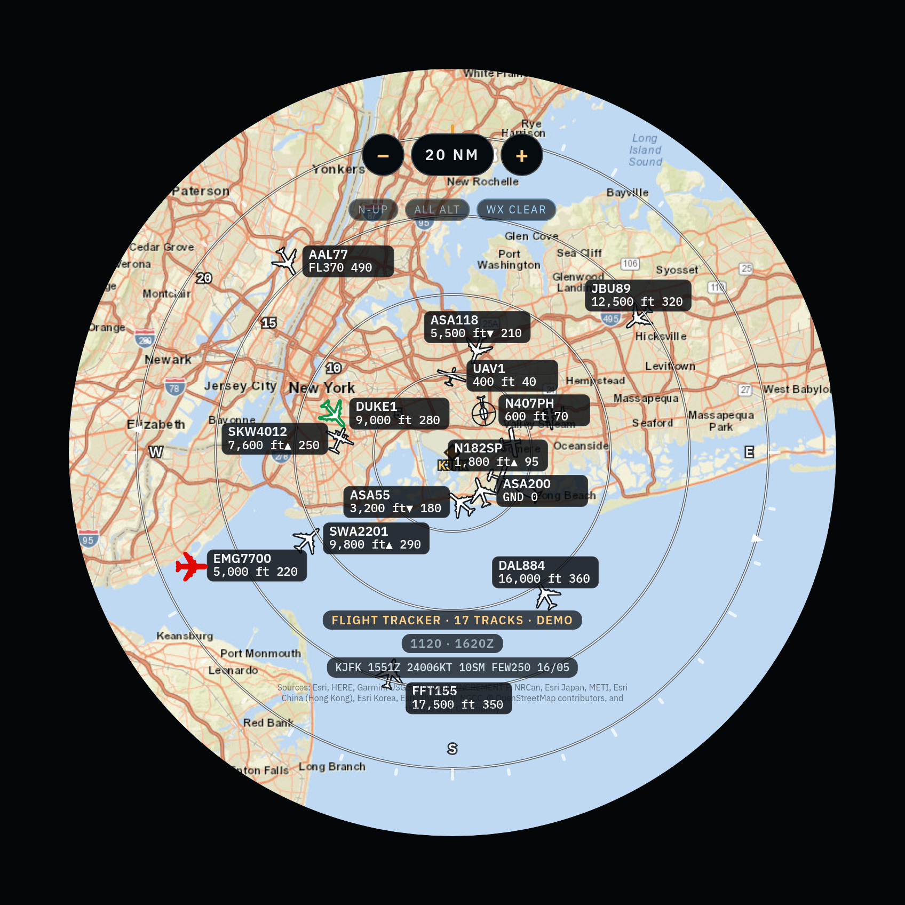
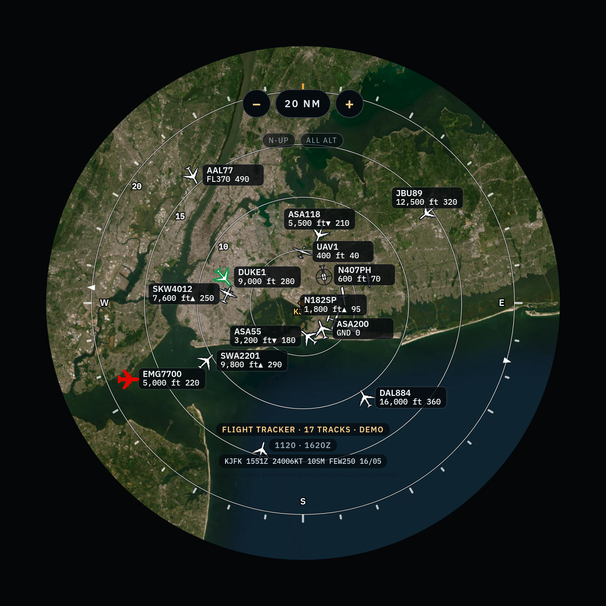
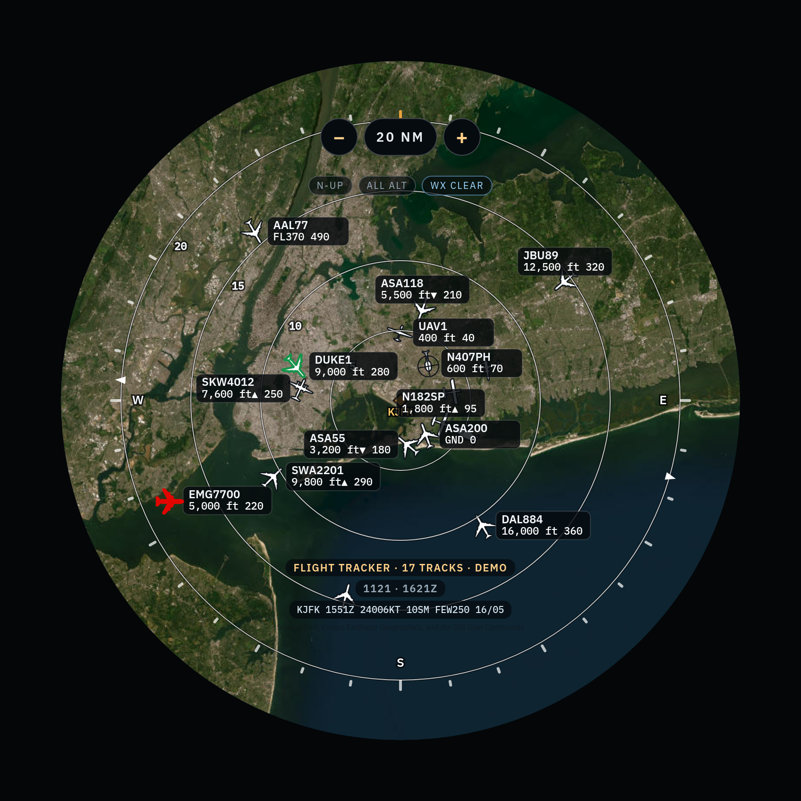
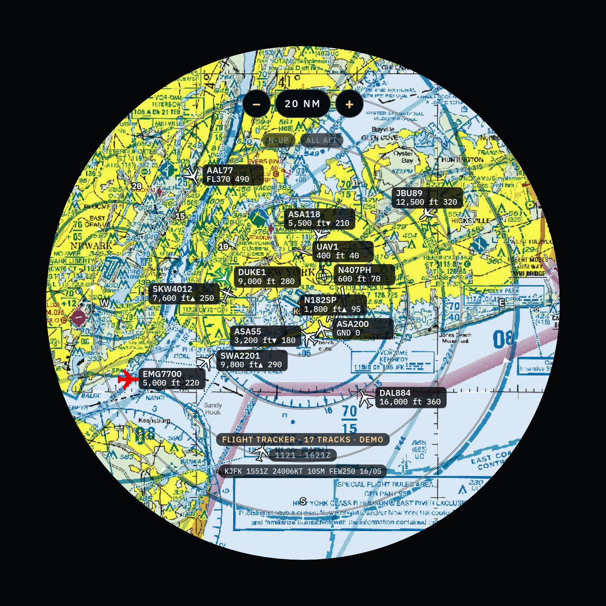
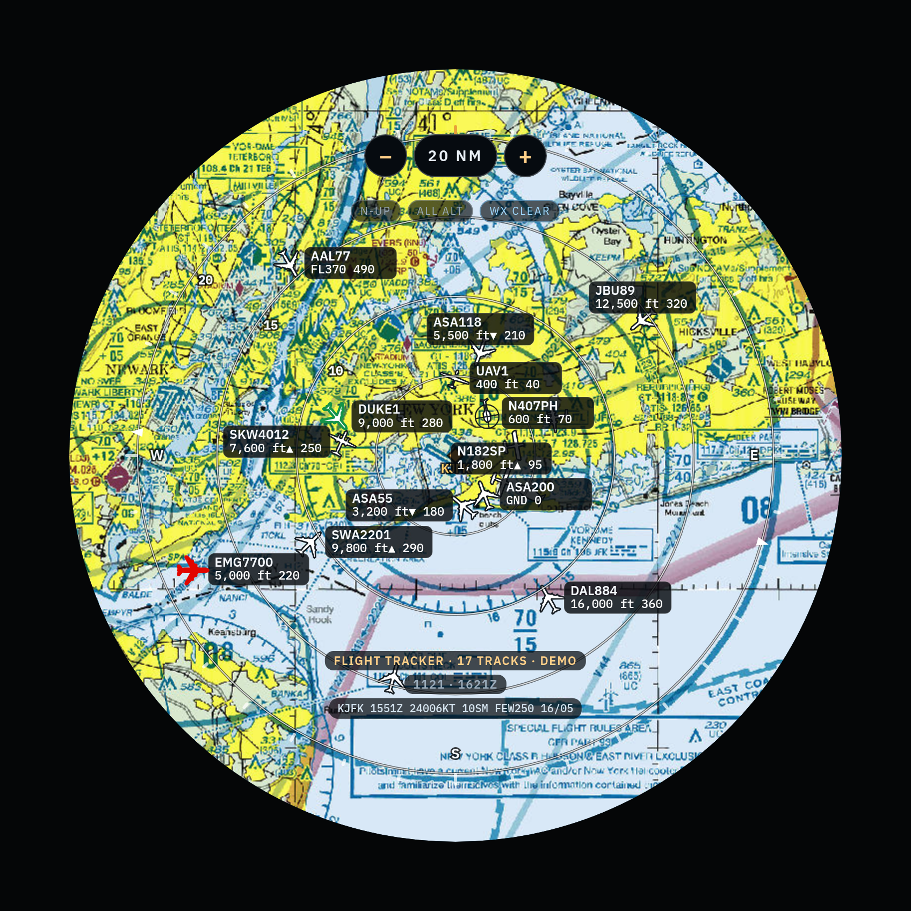
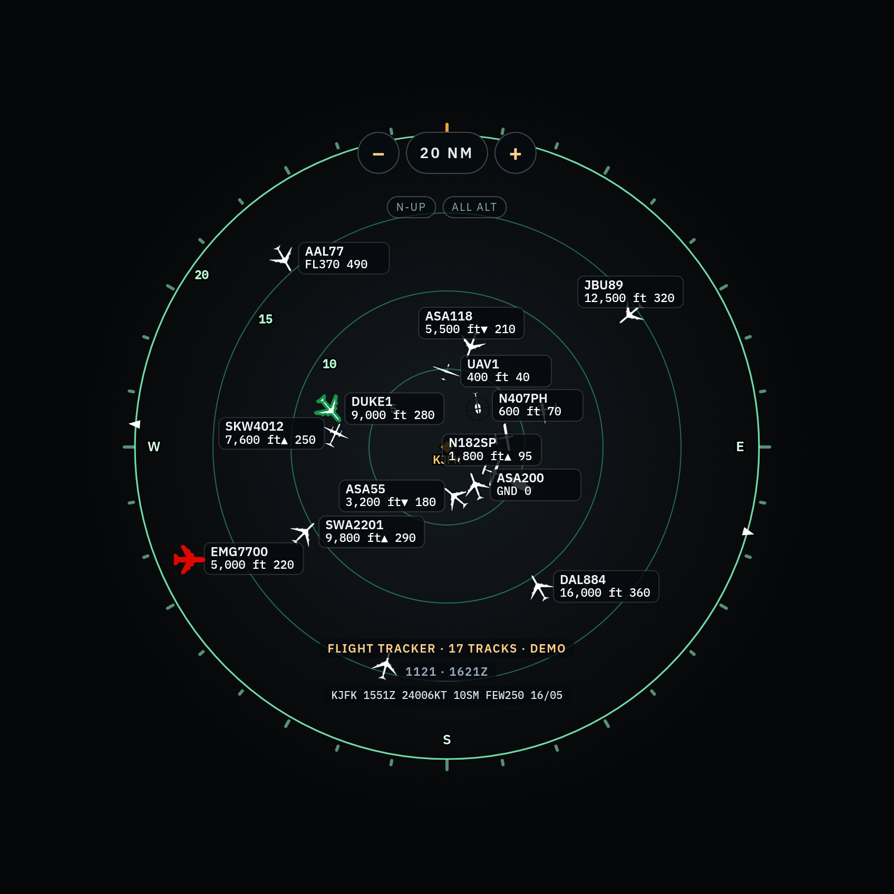
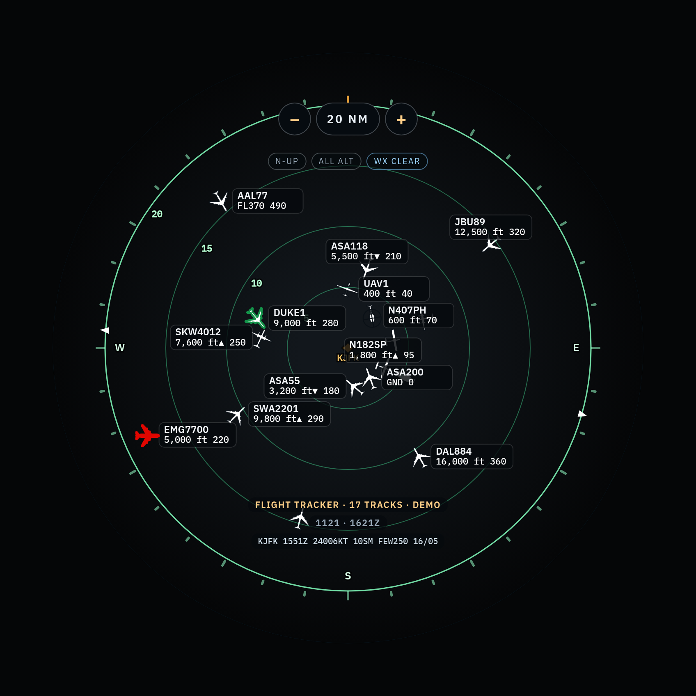

# Software

[Flight Tracker](../README.md) / Software

**[README](../README.md)** · [Build guide](BUILD.md) · **Software** · [Signed updates](tokenless-updates.md) · [Wi-Fi QR test](wifi-qr-test.md)

How to install, set up, and run Flight Tracker 1.0.18 — including the desktop demo, the display overlay, live aircraft data, and signed updates. For printing and assembling the case, start with the [build guide](BUILD.md). Print files are on the [MakerWorld listing](https://makerworld.com/en/models/3669492-aircraft-flight-tracker-desktop-ads-b-radar).

---

## Desktop demo

The production build is already in `dist/`. From this directory:

```bash
python3 server/flighttracker.py --demo --host 127.0.0.1 --port 8741
```

Open http://127.0.0.1:8741 . The round bezel is the case. The keys on the glass are the touch targets. On a machine with a wide window you also get the printed legends outside the glass. Add `?kiosk=1` for the full-screen panel layout.

Sample traffic is fictional and flies out and back around KJFK. `--demo` ignores the saved feed until you start the server without that flag.

Keyboard, for the simulator: `M` map, `T` traffic, `W` weather, `U` menu, `N` clear selection, `H` heading mode, `A` altitude filter, `B` brightness, `+`/`-` range, scroll to zoom, Escape to close a panel. The map stays centred on the home location from Settings; it cannot be panned.

To change the UI and rebuild:

```bash
npm install
npm run build
python3 -m unittest discover -s server/tests -v
```

`npm run dev` serves the UI on port 8742 and proxies `/api` to the Python server on 8741.

## What you see

Traffic is centred on a home latitude and longitude. Each aircraft is a planform icon turned to its track, with a one-line tail-number box (registration when the feed has it, otherwise the callsign, then the ICAO hex). Altitude is colour-coded on the icon. Helicopter rotors spin while the body keeps its heading. Tap the tail-number box — not the icon — to open the detail card: identity, altitude, speed, track, vertical speed, distance, bearing, squawk and category. A row in the traffic list does the same and still shows the flight data. Range rings match the selected range. North is marked. Targets just outside the range sit on the outer ring as ticks. A small © 2026 Maverick Field Gear line sits at the bottom of the glass, above the south S.

Backgrounds, cycled by **MAP**:

| Background | Source |
| --- | --- |
| Dark map | Esri World Dark Gray Canvas, with the reference labels overlaid |
| Light map | Esri World Street Map |
| Satellite | Esri World Imagery |
| Sectional | FAA VFR sectional raster, published by FAA Aeronautical Information Services |
| Radar scope | Drawn in the app. No tiles |

**WX** turns precipitation on and off. Opacity is only on the setup page, in 10 percent steps from 10 to 100, default 60. Frames animate from RainViewer. If that service is unreachable, the server uses the Iowa Environmental Mesonet NEXRAD composite instead.

The nearest METAR comes from the Aviation Weather Center. It is a short line above the copyright notice.

## Screenshots

Rendered in the round frame from the demo, home at KJFK, 20 NM. Weather frames are whatever RainViewer published at capture time.

| | Clear | Precipitation |
| --- | --- | --- |
| Dark map |  |  |
| Light map |  |  |
| Satellite |  |  |
| Sectional |  |  |
| Radar scope |  |  |

## Hardware

Target board: Raspberry Pi 4. The panel checked against Waveshare’s own pages is the 4-inch round DSI touch display.

Two current Waveshare products share that size. Confirm the model on the board before editing boot config. The wiki for [4inch DSI LCD (C)](https://www.waveshare.com/wiki/4inch_DSI_LCD_(C)) says its overlay does not apply to [4-DSI-TOUCH-C](https://www.waveshare.com/wiki/4-DSI-TOUCH-C).

| | 4inch DSI LCD (C) | 4-DSI-TOUCH-C |
| --- | --- | --- |
| Resolution | 720 × 720 | 720 × 720 |
| Overlay on DSI1 | `dtoverlay=vc4-kms-dsi-waveshare-panel,4_0_inchC` | `dtoverlay=vc4-kms-dsi-waveshare-panel-v2,4_0_inch_c` |
| Display area | 101.52 × 101.52 mm on the 720 × 720 round panel | same, from the [product page](https://www.waveshare.com/4-dsi-touch-c.htm) |
| Touch | 10-point capacitive, I2C | 10-point capacitive, I2C |
| Refresh | up to 60 Hz | up to 60 Hz |
| Backlight | `echo N \| sudo tee /sys/class/backlight/*/brightness`, N from 0 to 255 | not this product |

The kit uses **4inch DSI LCD (C)**. That is the installer default on a Pi 4. `--panel touch-c` is only for the other board, [4-DSI-TOUCH-C](https://www.waveshare.com/wiki/4-DSI-TOUCH-C), which the (C) wiki says not to configure with the (C) overlay.

From the [4inch DSI LCD (C) wiki](https://www.waveshare.com/wiki/4inch_DSI_LCD_(C)), checked for this build:

- Bookworm and Trixie: add `dtoverlay=vc4-kms-v3d` and `dtoverlay=vc4-kms-dsi-waveshare-panel,4_0_inchC`. The wiki’s `,dsi0` form is for boards with two MIPI ports (Pi 5 and Compute Modules). A Pi 4 has one DSI connector, the 15-pin FPC, plus the 4-pin lead for 5 V and I2C. The installer writes the Pi 4 line only.
- Touch on Bookworm and Trixie: the wiki says the touch works after that overlay boots. It does not install a separate touch package. The rotation steps identify the device as **10-0014 Goodix Capacitive TouchScreen**. Binding that touchscreen to the panel in Screen Configuration is a manual step if you rotate the display. The installer does not do that.
- Bullseye and Buster are a different driver. The manual example is `sudo bash ./WS_xinchDSI_MAIN.sh 40C I2C0`. A preinstalled-image snippet on the same page uses `I2C_bus=10`. Those are not the same instruction, so the installer does not write a Bullseye touch overlay.
- Backlight, terminal method: `echo N | sudo tee /sys/class/backlight/*/brightness`. `N` is 0 (darkest) through 255 (brightest). The wiki does not name the backlight device, so the glob is used as published. **BRT** stores a percent and writes `round(percent / 100 * 255)` with that command. The desktop demo has no backlight node, so it darkens the page instead. On the Pi the page is not darkened again when a backlight node exists.

Waveshare lists the display area as a square. The glass is round, and they do not publish a smaller active-pixel diameter inside the 720 × 720 framebuffer. The visible image is the inscribed circle: diameter 101.52 mm, 720 px. Flight Tracker clips all drawing to that circle.

```bash
sudo bash install.sh
sudo bash install.sh --panel touch-c
```

Reboot after the overlay is added.

A cooling fan can be fitted in the case. The display software does not PWM a fan header. If the fan is wired as a Raspberry Pi `gpio-fan` (control pin to a transistor, not a direct motor connection), turn that on in the config or install with `--fan`. The default control pin is BCM 14 and the default threshold is 60 °C, which the installer writes as `dtoverlay=gpio-fan,gpiopin=14,temp=60000`.

### Live aircraft data

The default source (`feed.mode` `adsbfi`) is the free [adsb.fi](https://adsb.fi/) open data API over the internet, so no receiver is needed. The display asks `https://opendata.adsb.fi/api/v3/lat/{lat}/lon/{lon}/dist/{nm}` for aircraft around home, with the radius set to the display range plus a margin (at most 250 NM). adsb.fi limits public requests to one per second. Flight Tracker sends at most one request every 5 seconds, however many screens are open. It caches the last answer, and after an error it waits twice as long each time, up to 5 minutes (at least 60 seconds after HTTP 429). Requests time out after 6 seconds and carry a `FlightTracker/<version>` User-Agent. If adsb.fi cannot be reached and `fallbackDemo` is on, the scope shows demo tracks marked DEMO · NO FEED. The last good answer is shown as STALE for up to 60 seconds.

adsb.fi terms: the open data is for personal, non-commercial use only. adsb.fi must be cited with a link to https://adsb.fi/. The credit is in MNU About → Sources and on the setup page. adsb.fi asks users to support it by running a receiver. In adsb.fi data, `type` is the message source (for example `adsb_icao`), not the aircraft type, so the aircraft type is read from `t` only.

### Receiver

Choose **My receiver** on the setup page (`feed.mode` `local` or `remote`) to use your own readsb or dump1090 `aircraft.json`. The default local path is `/run/readsb/aircraft.json`. dump1090-fa often uses `/run/dump1090-fa/aircraft.json`. A remote receiver is any HTTP or HTTPS URL that returns the same document, for example `http://receiver.local:8080/data/aircraft.json`.

Fields that are read: `hex`, `flight`, `lat`, `lon`, `alt_baro` (including `"ground"`), `alt_geom`, `track`, `true_heading`, `mag_heading`, `gs`, `baro_rate`, `geom_rate`, `squawk`, `category`, `seen_pos`, `seen`. Aircraft without a position are skipped.

## First boot

1. Flash Raspberry Pi OS Bookworm or Trixie with a desktop. Connect the 4inch DSI LCD (C) with the 15-pin FPC and the 4-pin power/I2C lead.
2. Clone this repository and run `sudo bash install.sh`. Add `--admin-password` only if the setup page should ask for one. It is off by default.
3. Reboot. The hostname is `flighttracker`. Avahi answers `flighttracker.local`.
4. If the Pi has no saved Wi-Fi, or a saved network is out of range for about two minutes after boot, it raises a WPA2-PSK hotspot named **FlightTracker-Setup** (PMF not required, so iPhones can join). The password is random per device, eight letters, and is shown under the QR code on the round display. A phone camera can scan `WIFI:T:WPA;S:FlightTracker-Setup;P:<password>;;`.
5. When the phone associates, the display switches to a second QR code for `http://10.42.0.1/`. That is the setup hotspot address (pinned in NetworkManager). On that hotspot, `http://flighttracker.local/` also resolves to the unit. Save the home Wi-Fi there.
6. After the home network connects, the card changes to “Connected” and a QR code for the unit’s current IPv4 address, then closes. Join that same Wi-Fi on your phone, then scan or type the address. `http://flighttracker.local/` works when the network allows mDNS.
7. **MNU → WI-FI SETUP** opens the card again. If the setup network is not already up (for example after a move, while saved Wi-Fi is out of range), this starts it immediately.

The scope opens centred on KJFK, New York John F. Kennedy International Airport. The reference point is latitude 40.6399, longitude -73.7787, the FAA airport reference point reported by the Aviation Weather Center airport API (`type` ARP, `source` FAA). METAR starts at KJFK and follows the home airport when you change home by airport search. A latitude and longitude home uses the nearest station, unless you type a METAR station on the setup page. The setup page can still change home (latitude and longitude, or an onboard airport-code search), range, background, weather and opacity, METAR station, units, brightness, and the ADS-B source. **Test connection** reads the file or URL and reports how many aircraft have a position. Save writes `/etc/flight-tracker/config.json` and the running display picks it up without a reboot. **Restart display** restarts the Chromium kiosk. **Reset defaults** restores the built-in settings.

The round display opens the Join setup card only while the FlightTracker-Setup hotspot is actually up. While it is waiting for a saved network after boot, that card stays hidden. QR codes are drawn on the Pi with the open-source `qrcode` library. No QR image is fetched from the network.

TODO: the hotspot, captive-portal redirects, `10.42.0.1`, `iw` station detection, WPA2-PSK/PMF settings, the two-minute fallback, and AP/STA retries were not run on a Raspberry Pi. The scripts call Raspberry Pi OS Trixie NetworkManager (`nmcli dev wifi hotspot` on brcmfmac). If the radio is not `wlan0`, edit `scripts/wifi-ctl.sh`.

## Install on the Pi

Flash Raspberry Pi OS with a desktop (Bookworm or Trixie). Clone this repository, then:

```bash
sudo bash install.sh
```

That script:

- installs Python 3, certificates, DejaVu, and Chromium when `apt` can
- copies the app to `/opt/flight-tracker`
- keeps settings in `/etc/flight-tracker/config.json` (created from the example on first install)
- caches tiles in `/var/cache/flight-tracker`
- enables `flight-tracker.service` (the local server on port 8741)
- enables `flight-tracker-kiosk.service` (Chromium fullscreen on `?kiosk=1`)
- appends the 4inch DSI LCD (C) overlay for a Pi 4 when no Waveshare DSI overlay is already there
- sets the hostname to `flighttracker` and enables Avahi
- allows backlight, Wi-Fi helper, and kiosk restart through sudoers
- enables a service that starts the setup hotspot when no Wi-Fi is saved, or when saved Wi-Fi stays down for about two minutes, and retries saved networks while the hotspot is up

Optional GPIO buttons need `python3-gpiozero`, which the installer tries to add. The kiosk script waits for Wayland or X11 and passes `--ozone-platform=wayland` when `wayland-0` exists. That path has not been run on a physical Pi in this project’s test environment.

## Configuration

`data/config.example.json` is the template. On the Pi the live file is `/etc/flight-tracker/config.json`. In a checkout the server creates `data/config.json` on first launch. The **MNU** screen edits the same fields and saves them immediately.

| Field | Meaning |
| --- | --- |
| `home` | Name, latitude, longitude of the scope centre |
| `rangeNm` | Range in nautical miles. The display converts it for statute and metric units |
| `units` | `aviation` (NM, kt, ft), `imperial` (mi, mph, ft), or `metric` (km, km/h, m) |
| `feed.mode` | `demo`, `local`, or `remote` |
| `feed.localPath` | Absolute path to `aircraft.json` |
| `feed.remoteUrl` | `http` or `https` URL. No API key is stored |
| `feed.fallbackDemo` | If the local file is missing, play the sample tracks and say so |
| `background` | `dark`, `light`, `satellite`, `sectional`, or `scope` |
| `weather.enabled`, `opacity`, `animate` | Precipitation overlay |
| `metar` | Nearest observation |
| `orientation` | `north` or `track` |
| `facingDeg` | Used for track-up when no aircraft is selected |
| `altitudeBand` | `all`, `low` (below 10,000 ft), `mid`, `high`, `upper` |
| `brightness` | 0–100. Written to the panel as 0–255 with the Waveshare terminal command |
| `metarStation` | ICAO code. Follows the home airport when home is set by airport search; blank uses the nearest observation |
| `feed.mode` | `adsbfi` (default, internet), `local` (receiver file), `remote` (receiver URL), or `demo` |
| `feed.host`, `feed.port` | readsb/dump1090 host. The JSON URL is `http://host:port/data/aircraft.json` unless `remoteUrl` is set |
| `gpio` | Optional buttons and encoder. Off by default |
| `fan` | Optional `gpio-fan` pin and temperature |

Track-up rotates the chart so the selected aircraft’s track is at the top of the glass. With nothing selected, it uses `facingDeg`. Rotation is around the home location. **NAV** clears the selection. The centre itself changes only on the setup page.

## Control map

Each function has one place. The eight glass keys match the printed bezel and do not appear again as duplicate controls.

| Control | Where | What it does |
| --- | --- | --- |
| MAP | Glass key | Next map background |
| TFC | Glass key | Traffic list |
| WX | Glass key | Weather overlay on or off |
| MNU | Glass key | About, radar sweep on or off, reopen the Wi-Fi card. A dot appears beside About when a checked update is waiting. It is not a button |
| Software updates | Setup page, Software section | Current version, check, release notes, install, and the night auto-update switch. Off by default |
| Tail-number box | Glass, next to each aircraft | Tap to select and open the detail card. The icon itself is not a hit target. NAV clears the selection. The map stays centred on the home location from Settings |
| NAV | Glass key | Clear the selection. The map stays centred on the home location from Settings |
| HDG | Glass key | North-up or track-up |
| ALT | Glass key | Next altitude filter |
| BRT | Glass key | Backlight. Steps 100, 80, 60, 40, 20 percent. The encoder moves it by 5 |
| Range readout | Glass, under the top key | − and + step 10, 20, 30, 40, 50, 75, 100 nm (100 is the maximum). The value between them is the current range. Scroll and pinch do the same. Rings animate; the outer ring is the selected range |
| Default range | Setup page only | The range used at startup |
| Radar sweep | MNU, and the same switch on the setup page | Green sweep line and fading trail on every background. The map keeps its own colours. Off by default |
| Icon set | Setup page only | Maverick is the default. Linecut, Classic, Planform, and Compact stay available |
| Sweep speed | Setup page only | 2–6 seconds per revolution, default 4 |
| Weather opacity | Setup page, Weather | 10–100 percent, steps of 10, default 60. The WX key only turns the overlay on or off |
| Location | Setup page, Location section | Airport code (ICAO or IATA) or latitude and longitude. Save applies it. The glass stays centred there; it cannot be panned on the display |
| Units, METAR, ADS-B source, demo mode, Wi-Fi join, restart, reset | Setup page only | `http://flighttracker.local/` |
| Watch list | Setup page, Watch | Tails or hex. Off by default. Glass shows only a WATCH count |
| Alerts | Setup page, Alerts | Flash and optional chime. Off by default |
| Trails | Setup page, Trails | Fading history, off by default |
| Night dim | Setup page, Night | Sunrise or a fixed schedule |
| Receiver | Setup page, Receiver | Rate, count, signal if present, last-message age |

The status chips on the glass (N-UP, altitude band, WATCH count) only show the current state. They are not second copies of the keys.

The map fills the round glass. Text and cards stay inside a margin equal to 90 percent of the radius, because the bezel overlaps the edge. Long labels ellipsize.

Range rings are redrawn for the selected range. At 10 nm they read 2.5, 5, 7.5, 10. At 30 nm they read 10, 20, 30. At 40 nm they read 10, 20, 30, 40. At 50 nm they read 10, 20, 30, 40, 50. At 75 nm they read 25, 50, 75. At 100 nm they read 25, 50, 75, 100. Auto (the default) picks the ring count so those labels stay even and round; a fixed count of 2–6 can still be set on the setup page. Changing range eases the rings and the scale instead of jumping.

Aircraft icons follow the ADS-B emitter category: A1/A2 light, A3–A6 jet, A7 rotorcraft, B2 lighter-than-air, B6 UAV. Anything else stays a neutral diamond. Maverick, the default set, uses a separate filled silhouette for a light single, a twin, a business or regional jet, an airliner, a fighter, and a drone. Helicopters and airships keep the Linecut shapes. Every aircraft is white with a thin dark outline. Military is a green outline (`#14944A`), distinct from the sweep. A squawk of 7500, 7600, or 7700, or a readsb emergency flag other than none, flashes the icon red about once a second and overrides the green outline. A watched aircraft has a cyan ring while the watch list is on. It comes from readsb `dbFlags` bit 0. An optional `data/military-hex-ranges.json` is used only when you add one; the usual compiled table has no license, so it is not included. An optional `data/aircraft-types.json` can map an ICAO type designator to a class when the category is empty. The legend is in MNU About only.

The watch list accepts a US N-number, which converts to the ICAO address offline, another registration matched to readsb's `r` field or `data/registrations.json`, or a 6-digit hex. Hyphens and case are ignored.

The flight card does not show origin or destination. No keyless, licence-compatible route feed was reliable enough to depend on, so the card does not guess a route.

Alerts flash inside the glass and play a short tone only when an audio device accepts it. Night dim uses an offline sunrise calculation from the home coordinates, or the hours you set. An empty scope shows the time, the nearest airport from the onboard database, and the METAR, then returns to the map when traffic is back.

## Bezel

The legends are printed on the case (case print files: CC BY-NC-ND 4.0, see License). They are not electrical switches, and the glass does not draw those names again. Invisible touch zones sit just inside the round edge, in the same order as the table above. A tap shows a short glow and no text. The range readout and the N-UP / altitude chips show state, not key names.

## Optional GPIO

Leave `gpio.enabled` false until real switches are wired. Inputs are BCM, active-low to ground, internal pull-up. The encoder is quadrature; one detent is four edges. Swapping `clk` and `dt` reverses the direction. The encoder switch also fires **BRT**.

Default pins, chosen to avoid I2C (GPIO 2 and 3, used by the panel touch controller) and the default fan pin 14:

| Function | BCM |
| --- | --- |
| MAP, TFC, WX, MNU | 5, 6, 16, 17 |
| NAV, HDG, ALT, BRT | 22, 23, 24, 25 |
| Encoder clk, dt, sw | 12, 13, 20 |

The server prefers `gpiozero` and falls back to `lgpio`. If neither can open the chip, the display keeps running and `/api/controls` reports the error. Nothing in the default config claims a pin.

## Data sources and attribution

No paid API key is embedded. Tiles and radar images are cached on disk so the scope keeps the last view when the network drops. Delete `/var/cache/flight-tracker` (or `data/cache` in a checkout) to force a refresh.

| Layer | Terms |
| --- | --- |
| Dark and light maps | Esri basemaps. The glass shows the service copyright text and nothing else. Dark canvas: “Esri, HERE, Garmin, © OpenStreetMap contributors, and the GIS user community”. Streets: “Sources: Esri, HERE, Garmin, USGS, Intermap, INCREMENT P, NRCan, Esri Japan, METI, Esri China (Hong Kong), Esri Korea, Esri (Thailand), NGCC, © OpenStreetMap contributors, and the GIS User Community”. [Esri attribution](https://www.esri.com/en-us/legal/terms/data-attributions). OpenStreetMap data in those two maps is [ODbL](https://www.openstreetmap.org/copyright). “Powered by Esri” is in MNU and on the setup page |
| Satellite | Esri World Imagery. On the glass: “Source: Esri, Vantor, Earthstar Geographics, and the GIS User Community” |
| Sectional | FAA VFR sectional chart tiles. US government work, so the glass shows no credit. Zoom levels 8–12. Outside that range, or outside chart coverage, the chart is omitted and the rings remain. [FAA digital VFR products](https://www.faa.gov/air_traffic/flight_info/aeronav/digital_products/vfr/). The black scope has no map and no credit line |
| Precipitation | [RainViewer Weather Maps API](https://www.rainviewer.com/api.html), free for personal and educational use, past frames only, max zoom 7. RainViewer asks for “Weather data by RainViewer” with a link to https://www.rainviewer.com/ somewhere visible in the app, not on the map. That credit is in MNU and on the setup page. Fallback: Iowa Environmental Mesonet NEXRAD composite, https://mesonet.agron.iastate.edu/ , which states no on-map credit |
| METAR | Aviation Weather Center Data API, https://aviationweather.gov/data/api/ . Public NOAA/NWS observation |

IBM Plex Sans and IBM Plex Mono are used for the UI under the SIL Open Font License.

### License

Flight Tracker is source-available, not open source. It is released under the **Maverick Field Gear Flight Tracker License** ([LICENSE](../LICENSE)), copyright 2026 Maverick Field Gear:

- Free to download, install, and run on your own personal, non-commercial builds.
- No modification and no distribution of modified versions. Changing settings on the setup page or in `config.json` is allowed.
- No commercial use: no selling the software, or devices, kits, or images that include it.
- You may share unmodified official releases, with the license and credit ("Flight Tracker by Maverick Field Gear", linking to https://github.com/MFG001/flight-tracker).
- Updates come only from official signed releases.
- No warranty. Not for navigation or any safety-of-flight use.

The 3D-printable case files are published separately under [CC BY-NC-ND 4.0](https://creativecommons.org/licenses/by-nc-nd/4.0/) (Creative Commons Attribution-NonCommercial-NoDerivatives 4.0 International), not under the software license.

Bundled third-party components (node-qrcode, IBM Plex fonts) keep their own licenses; see [THIRD_PARTY_NOTICES.md](../THIRD_PARTY_NOTICES.md). Map, weather, and aircraft data terms stay with their owners.

## Software updates

Updates come from the public GitHub repository `MFG001/flight-tracker`. No account, access key, or token is needed (1.0.7 and later). The device downloads:

`https://github.com/MFG001/flight-tracker/releases/latest/download/manifest.json`

That address is a plain file download, not the GitHub API, so the API rate limit does not apply. Downloads are HTTPS only, send no credentials, and may only be redirected to `github.com`, `release-assets.githubusercontent.com`, or `objects.githubusercontent.com` on port 443. The tarball must be an asset of a release in the same repository, and its size must match the signed size exactly.

Because anyone can read the releases, trust comes from the signature, not from the download location. The release key fingerprint is:

`2D7C 0580 0B69 E5EA` (sha256 of the public key: `2d7c05800b69e5ea9c356933856435ce37f6f7e879de6a0ab7e0956b4d5c25c0`)

The Software card on the setup page shows the same first 16 characters under "Signing key". Check it with:

```bash
openssl pkey -pubin -in deploy/update-public.pem -outform DER | sha256sum
```

The pinned keys live in `/etc/flight-tracker-keys`, owned by root. The web server cannot write them. Before anything is unpacked, the updater checks:

- an Ed25519 signature by a pinned release key over every field of `manifest.json` (format 2)
- product `flight-tracker`, channel `stable`, and a download address in the repository the device follows
- the version is newer than the running one and not below a signed minimum (no downgrade to an old, signed release)
- the manifest is not older than the newest one the device has already accepted (no replay); an optional expiry is enforced only once the clock is set
- the sha256 and size of the tarball
- the tarball contents: no links, devices, or setuid files, at most 20,000 files and 400 MB unpacked

A new release key can be added, or an old one revoked, only by a manifest that is also signed by a root key the device already trusts. The private keys stay off the repository and off the Pi. See `docs/tokenless-updates.md` for the full design.

The signature covers `flight-tracker-update-v2` and a newline, followed by the manifest as canonical JSON (keys sorted, no spaces, ASCII) without its `signatures` field. `manifest.json` looks like:

```json
{
  "channel": "stable",
  "expires": "",
  "format": 2,
  "minVersion": "1.0.0",
  "notes": "What changed.",
  "product": "flight-tracker",
  "published": "2026-11-20T12:00:00Z",
  "sha256": "<64 lowercase hex characters>",
  "size": 123456,
  "url": "https://github.com/MFG001/flight-tracker/releases/download/v1.2.3/flight-tracker-1.2.3.tar.gz",
  "version": "1.2.3",
  "signatures": [{"keyId": "<sha256 of the public key>", "sig": "<base64 Ed25519 signature>"}]
}
```

Nothing in the update opens a new inbound port or a remote shell.

Cut a release from a checkout that already has `npm run build`. Keep the private key outside the tree:

```bash
python3 scripts/release.py \
  --key "$HOME/keys/flight-tracker-release.key" \
  --base-url https://github.com/MFG001/flight-tracker/releases/download/v1.2.3 \
  --version 1.2.3 \
  --notes "What changed."
python3 tools/sign_release \
  --key "$HOME/keys/flight-tracker-release.key" \
  --version 1.2.3 \
  --notes-file notes.txt \
  release-out/flight-tracker-1.2.3.tar.gz
```

`tools/sign_release` is the signer. It refuses a key path inside the repository, runs the personal-data scrub check on the tarball and the notes, and writes `public/manifest.json` (format 2). Upload `flight-tracker-1.2.3.tar.gz` and that `manifest.json` as assets on the GitHub release tagged `v1.2.3`, and mark it the latest release.

The web server runs as its own system account, `ft-server`, not the desktop login. The code in `/opt/flight-tracker` and the update keys are owned by root. Units updated from 1.0.6 switch to `ft-server` about five minutes after 1.0.7 passes its start-up check, and switch back by themselves if the server does not come up healthy that way.

INSTALL UPDATE (1.0.4) runs `sudo -n /usr/local/sbin/flight-tracker-update --install`, which hands `updater.py --install` to systemd as the transient unit `flight-tracker-apply.service` with `--no-block` and returns at once, so a sudo or systemd failure shows on the Software card right away. The updater writes each step to `update-status.json` (1 checking, 2 downloading with MB progress, 3 verifying, 4 restarting, then complete, rolled back, or failed); the card polls `/api/updates` every 1.5 s and shows "reconnecting" while the service restarts. After the new version passes its start-up check, the updater copies the new release's `deploy/flight-tracker-update` over the installed helper and restarts `flight-tracker-kiosk.service`, so the round screen reloads on the new version. Devices on 1.0.2 or 1.0.3 carry the old helper, whose `--install` never ran; install 1.0.4 on those once with `deploy/push-update.sh` (or `install.sh`).

### Install a release from a Mac over Wi-Fi

Run these on the Mac (in Terminal), not on the Pi. Download `flight-tracker-X.Y.Z.tar.gz` from the release first; Safari may unzip it to `.tar`, which also works.

```bash
cd ~/Downloads
tar xf flight-tracker-X.Y.Z.tar* deploy/push-update.sh
bash deploy/push-update.sh ~/Downloads/flight-tracker-X.Y.Z.tar* flighttracker@flighttracker.local
```

It asks for the Pi password for ssh, then again when `sudo` on the Pi asks. 1.0.6 runs the install step from a script file on the Pi with a real terminal, so that sudo prompt works (1.0.3-1.0.5 failed with "sudo: a terminal is required to read the password"). If `flighttracker.local` does not resolve, use the Pi's IP address. When it finishes it prints `flight-tracker.service is running X.Y.Z`.

Without the script, also from the Mac:

```bash
cd ~/Downloads
scp flight-tracker-X.Y.Z.tar* flighttracker@flighttracker.local:/tmp/
ssh -t flighttracker@flighttracker.local 'rm -rf /tmp/ftnew && mkdir -p /tmp/ftnew && tar xf /tmp/flight-tracker-X.Y.Z.tar* -C /tmp/ftnew && cd /tmp/ftnew && sudo bash install.sh; cd /; rm -rf /tmp/ftnew /tmp/flight-tracker-X.Y.Z.tar*'
```

On the Pi the tree lives in `/opt/flight-tracker/releases/<version>` and `/opt/flight-tracker/current` points at one of them. The switch is atomic. The user config stays in `/etc/flight-tracker/config.json`. The new release can run `server/migrate.py` against that file. If the new service does not answer `/api/health` with its own version within about 60 seconds, `current` is pointed back at the previous release, the config copy from before the migration is restored, and the service is started again. The two newest good releases are kept.

The Software section on `http://flighttracker.local/` is the only place to check, read notes, install, or turn on auto-update. Auto-update is off by default. A daily check runs at about 09:00 AM Eastern (with a few minutes of random delay) so the on-screen Update available prompt appears while people are awake. A unit that was off at 9:00 catches up when it next comes on. Background checks 90 seconds after boot and every 6 hours are skipped between 21:00 and 09:00 Eastern, so they do not pop the prompt at night. Manual CHECK FOR UPDATES always runs at once.

Auto-update, when you turn it on, still installs in the quiet hours: the install is booked for the "Install later at" time (default 02:00 AM Eastern) without showing the prompt, and a 03:10 AM Eastern timer will also install if auto-update is on, the local hour is between 01:00 and 05:00, and nobody has touched the glass or the setup page in the last 15 minutes. MNU does not check or install. It only shows a dot in About after a check has found a newer signed release.

## Flashable Pi image

This repository does not emit a `.img` by itself. A flashable card is Raspberry Pi OS Bookworm or Trixie with a desktop, plus this tree after `npm run build`. The image hook, or first boot on the card, runs:

```bash
sudo bash install.sh
```

That creates the `ft-server` service account, installs the services, sets the hostname to `flighttracker`, writes `/etc/flight-tracker/config.json` from the example (home and METAR at KJFK) if it is not already there, copies `deploy/update-public.pem` once and pins it in `/etc/flight-tracker-keys`. Leave the public key file as it is. No token or password is needed for updates.

## Verified here, and not verified on the hardware

Verified in this environment, without a Raspberry Pi or the Waveshare panel:

- Python unit tests for the feed parser, demo motion, config checks, the encoder step table, and the signed updater
- A local HTTPS update server: a good release installed and stayed healthy, a deliberately broken release failed its health check and rolled back to the previous version, and unsigned, wrong-key, HTTP, and bad-hash manifests were refused
- Production build, then the demo server on port 8741
- Live fetches of Esri dark, street, and imagery tiles, FAA sectional tiles, RainViewer frames, and a KJFK METAR
- Screenshots of all five backgrounds with precipitation off and on, clipped to the round frame
- Bezel actions in a headless browser: traffic list, detail card, menu fields, weather toggle, track-up, and the altitude filter
- The setup page and the three Wi-Fi cards (join hotspot, open setup, connected), with QR codes drawn locally

Not verified, because this environment has no Pi 4 and no panel:

- The physical 720 × 720 glass, touch alignment, and whether the corners of the framebuffer are fully hidden by the bezel
- Which of the two Waveshare overlays the installed board needs
- Backlight sysfs writes, `gpio-fan`, and real button or encoder wiring
- systemd boot and the Chromium kiosk under Wayland or X11 on Raspberry Pi OS
- Frame rate on a Pi 4 with a live readsb feed
- Avahi at `flighttracker.local`, binding port 80, the setup hotspot, a phone joining from the QR code, and captive-portal detection
- A real over-the-air install on the Pi, including the systemd timer, the health-check restart, and rollback after a failed service start
- The touch zones lining up with the printed bezel legends. The glass no longer draws those names
- The BRT write to `/sys/class/backlight/*/brightness` on the real panel, including whether 0 only dims the backlight
- Which backlight node exists if the Pi also has another display. The wiki writes every match of the glob
- Sectional coverage outside the United States. The FAA tiles do not cover the whole world

The display math assumes the framebuffer is 720 × 720 and the visible area is the inscribed circle. If a future panel uses a different resolution, the kiosk still scales to the window, but the Pi overlay and the 720 px assumption in the README would need to be revisited.

---

[← Build guide](BUILD.md) · [README](../README.md) · [Signed updates →](tokenless-updates.md)

Software is under the [Maverick Field Gear Flight Tracker License](../LICENSE). Case print files are [CC BY-NC-ND 4.0](https://creativecommons.org/licenses/by-nc-nd/4.0/).

© 2026 Maverick Field Gear. All rights reserved.
